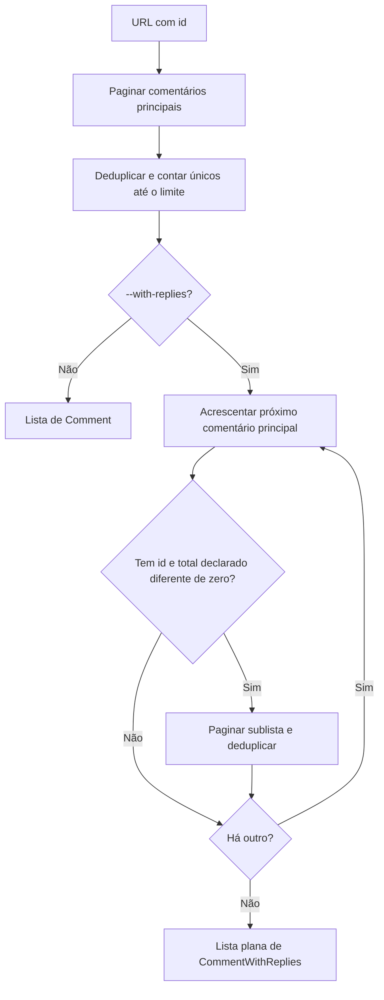

[⬅️ Fluxos](./README.md) · [🏠 Índice](../README.md)

# 🔀 Fluxo — Comentários e respostas

> **Resumo:** extrair o id da postagem, coletar os comentários principais e,
> só quando pedido, buscar as respostas de cada um numa lista plana.

## Etapas

1. **Extrair:** `get_photo_id` acha o id em `/video/<id>` ou `/photo/<id>`. Sem
   ele, `InvalidInput` (exit `2`). O host da URL não é conferido, e a URL
   original vira `postagem_url` sem alteração.
2. **Coletar os principais:** `get_root_comments` pagina com 50 por página,
   deduplica pela chave do comentário e para ao atingir o limite de únicos.
   Guarda junto o `sub_comment_count` de cada um.
3. **Sem respostas:** devolve os `Comment` como estão.
4. **Com respostas:** só depois de terminar os principais, percorre a lista.
   Cada principal vira `CommentWithReplies` com `respostas_total`.
5. **Elegibilidade:** busca respostas só se o principal tem `id` e o total
   declarado é truthy (não `None` e não zero).
6. **Expandir:** `get_replies` pede 100 por página em `sublist`, com cursor
   próprio. Cada resposta ganha `parent_id` (id do principal),
   `reply_to_id` (id do **usuário** respondido; `"0"` vira `null`) e
   `reply_to_usuario`.
7. **Deduplicar:** um conjunto único guarda as chaves dos principais e das
   respostas já incluídas. Uma resposta igual a um principal ou a outra
   resposta é descartada.
8. **Falhar:** qualquer erro em principais ou respostas descarta tudo (exit `1`).

O limite não controla respostas. `comments --limit 2 --with-replies` pode
gerar muitos itens e muitas chamadas. O total declarado fica no principal;
o coletor não avisa quando ele difere do número entregue. Prévias de respostas
embutidas em `subCommentsMap` não são usadas.

Volume observado: com `--limit 3 --with-replies`, 3 principais que declaravam
59, 18 e 4 respostas geraram 68 respostas no arquivo (71 itens).

## Regras envolvidas

[RN-004 a RN-007 — limite, dedupe, fim e respostas](../business-rules/collection.md) ·
[RN-008 e RN-011 — modelos e total declarado](../business-rules/data-contract.md) ·
[RN-012 e RN-015 — entrada e tudo ou nada](../business-rules/failure-policy.md).

## Referências

[UC-003](../use-cases/uc-003-collect-comments.md) · [Paginação](./pagination.md) ·
[Schemas](../reference/schemas.md#commentwithreplies) ·
[Protocolo móvel](../internals/mobile-api.md#commentsublist).

Verificação: `tests/test_cli.py` (`test_comments_com_respostas`,
`test_url_invalida_sai_com_2`), `tests/test_parser.py` (`test_parse_comment`).
