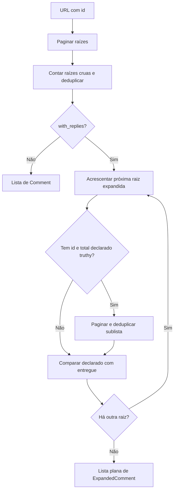

[⬅️ Fluxos](./README.md) · [🏠 Índice](../README.md)

# 🔀 Fluxo — Comentários e respostas

> **Resumo:** extrair id da postagem, coletar raízes e expandir respostas só
> quando solicitado, preservando vínculos e quantidade declarada.

## Etapas

1. **Extrair:** `extract_photo_id` reconhece id em `/video/` ou `/photo/`.
   Isso não valida o host completo da string de entrada.
2. **Coletar raízes:** `_collect_roots` pagina com tamanho 50, contando itens
   crus inclusive repetidos antes de deduplicar.
3. **Selecionar saída:** sem expansão, devolver raízes `Comment`. Com expansão,
   concluir primeiro a coleta de raízes e percorrer a lista resultante.
4. **Elegibilidade:** não consultar sublista para raiz sem id ou total
   `None`/zero. Como usa truthiness, um total negativo pode provocar consulta.
5. **Expandir:** pedir 100 em `sublist`, com cursor independente por raiz.
   Resposta vira `ExpandedComment` com `parent_id` e alvo de usuário `reply_to_*`.
6. **Deduplicar:** conjunto compartilhado nessa expansão evita repetir itens
   entregues. Sem id, a chave de autor/texto evita ambiguidade de delimitadores,
   mas pode fundir comentários legítimos idênticos.
7. **Conferir contagem:** total conhecido não negativo diferente da quantidade
   única entregue gera warning; não corrige o total nem fabrica resposta.
8. **Prosseguir ou interromper:** loop de sublista é warning local; outra
   falha de coleta interrompe com respostas lidas e raízes pendentes no parcial.

O limite de raízes não limita respostas. `comments --limit 2 --with-comments-replies` pode gerar
muitos itens e chamadas. Total declarado é preservado na raiz; a saída é plana.
Previews de `subCommentsMap` não são mesclados à sublista.

`CollectCommentVersions` compartilha a mecânica `_CommentReader` com
`CollectComments`, sem duplicar consultas de raízes. Entrega versões separadas
e etapa de falha explícita; não infere a origem pelo conteúdo do parcial.
Em `profile`, uma postagem com erro não impede as próximas. Veja [CLI](../guides/cli.md).

## Regras envolvidas

[RN-003 a RN-006 — coleta e expansão](../business-rules/collection.md) ·
[RN-007 e RN-010 — modelos e total declarado](../business-rules/data-contract.md) ·
[RN-012 a RN-015 — rejeição, parcial e loops](../business-rules/failure-policy.md).

## Referências

[UC-003](../use-cases/uc-003-collect-comments.md) · [Paginação](./pagination.md) ·
[Schemas](../reference/schemas.md) · [ADR de parcial/contagens](../adr/0004-partial-results-and-declared-counts.md).

Verificação: `tests/test_usecases.py`, `tests/test_mobile_captures.py`,
`tests/test_response_validation.py`.
