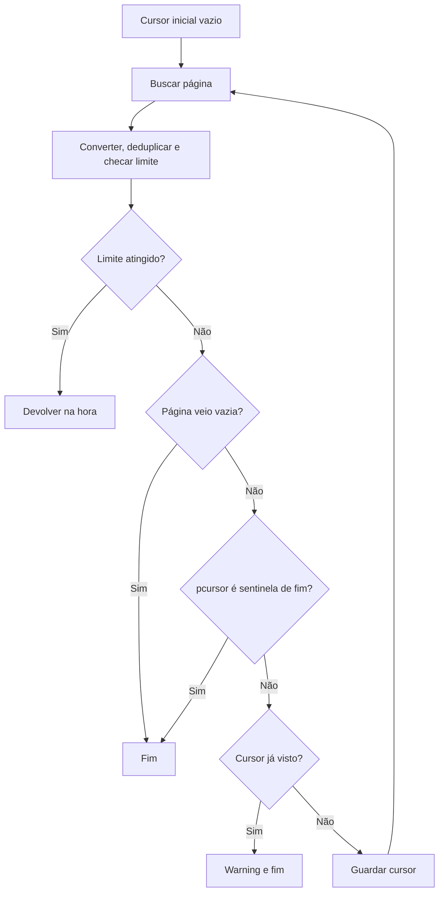

[⬅️ Fluxos](./README.md) · [🏠 Índice](../README.md)

# 🔀 Fluxo — Paginação

> **Resumo:** pedir uma página, processar os itens e seguir o `pcursor`
> devolvido até a página vir vazia, o cursor indicar fim ou se repetir.

## Etapas

1. **Iniciar:** cada laço começa com `cursor = ""` e pede a primeira página.
   Responsável: `get_user_posts`, `get_root_comments` e `get_replies` em
   [`scraper.py`](../../kwai_collector/scraper.py).
2. **Processar:** os itens da página são convertidos e deduplicados. Se o
   limite for atingido no meio da página, a função devolve na hora, sem pedir
   outra página.
3. **Ler o cursor:** `next_cursor` faz `str(data.get("pcursor") or "")`.
   Ausente, `None`, `0` ou string vazia viram `""`.
4. **Encerrar:** o cursor é de fim se estiver em `END_CURSORS`
   (`""`, `"no_more"`, `"nomore"`, `"-1"`, `"0"`).
5. **Detectar laço:** se o cursor já apareceu nessa paginação, registra
   `cursor repetido (...), parando a paginação` e encerra normalmente.
6. **Continuar:** guarda o cursor e pede a próxima página.

## O que conta como página vazia

| Operação | Teste de página vazia |
|---|---|
| Perfil | Lista de `Post` **depois** do parser. Feeds todos ignorados encerram a coleta. |
| Comentários principais | Lista crua `rootComments`. |
| Respostas | Lista crua `subComments`. |

## Efeito das falhas

| Condição | Resultado |
|---|---|
| Fim normal (vazia, sentinela ou cursor repetido) | Devolve o que coletou; exit `0`. |
| Limite atingido | Devolve na hora; nenhuma página extra. |
| Erro de rede esgotado, status de erro ou `result` de erro em qualquer página | Descarta tudo e sai com `1`. |
| Formato inesperado da lista | Pode gerar erro Python não tratado (exit `1`, com traceback). |

O tipo de `pcursor` não é validado: um valor que não seja string ou número é
convertido com `str()` e enviado como está. Não há cursor salvo entre
execuções; cada execução começa do início. Fim de cursor é o fim informado
pela API, não prova de que todo o conteúdo foi entregue.

## Regras envolvidas

[RN-006 — fim de paginação](../business-rules/collection.md#rn-006--fim-de-paginação) ·
[RN-015 — tudo ou nada](../business-rules/failure-policy.md#rn-015--saída-tudo-ou-nada).

## Referências

[Perfil](./profile.md) · [Comentários](./comments.md) ·
[Protocolo móvel](../internals/mobile-api.md) ·
[ADR-0004](../adr/0004-all-or-nothing-output.md).

Verificação: `tests/test_cli.py`, que simula a última página com
`pcursor: "no_more"` nos três fluxos paginados.
