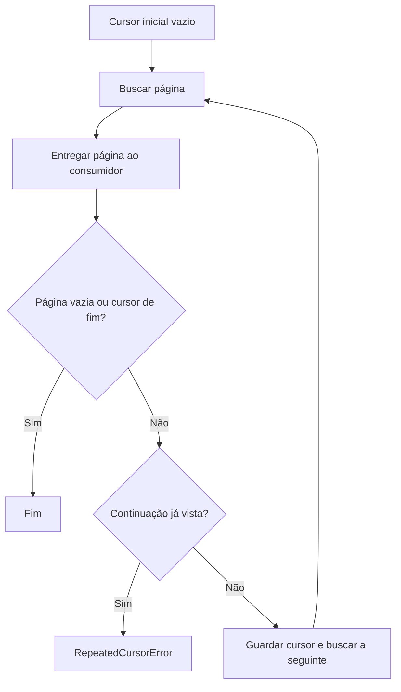

[⬅️ Fluxos](./README.md) · [🏠 Índice](../README.md)

# 🔀 Fluxo — Paginação e interrupção

> **Resumo:** buscar páginas sob demanda, seguir continuação e preservar o
> resultado disponível quando uma falha interromper o consumidor.

## Etapas

1. **Iniciar:** `iter_pages`, na aplicação, começa com cursor vazio e consulta a primeira página.
2. **Entregar:** `yield page` acontece antes da checagem de continuação.
3. **Encerrar:** página mapeada vazia ou cursor de fim encerra a iteração.
4. **Detectar loop:** `get_continuation_cursor`, no domínio, recebe os dados da
   página e os cursores vistos; continuação já vista gera `RepeatedCursorError`.
5. **Continuar:** guardar continuação e buscar só quando o consumidor solicitar.
6. **Preservar:** casos de uso convertem falhas cobertas com itens em parcial;
   a CLI decide a escrita e sinaliza falha pelo código de saída.

Fim: cursor vazio. O adapter traduz os sentinelas do Kwai (`no_more`, `nomore`,
`-1`, `0`) para vazio antes de entregar a página. Cursor inicial vazio não impede
a primeira consulta. Parar ao atingir um limite evita página extra e pode
evitar observar um ciclo que só seria acusado ao continuar consumindo.

## Efeito por unidade

| Falha/condição | Resultado |
|---|---|
| Primeira chamada sem itens acumulados | Propaga erro original. |
| Página posterior de perfil/raízes | `CollectionInterruptedError` com itens anteriores. |
| Raízes interrompidas, expansão pedida | Parcial de `Comment`; expansão ainda não começou. |
| Transporte/estrutura de sublista inválida | Mantém respostas já lidas e todas as raízes; interrompe expansão. |
| Loop de sublista | Mantém respostas, registra warning e segue próxima raiz. |
| Quantidade divergente | Warning com causa não determinada; não é interrupção por si só. |
| Escrita parcial falha | Exit `1` permanece; não há garantia de arquivo utilizável. |

Uma página de comentários rejeitada não entrega os seus itens válidos isolados.
Uma página entregue antes de acusar loop pode contribuir itens para o parcial.

Não há cursor salvo entre processos. Nova execução começa do início.
Persistência, merge e dedupe entre execuções pertencem ao consumidor.

## Regras envolvidas

[RN-005 — fim](../business-rules/collection.md#rn-005--fim-de-paginação) ·
[RN-012 a RN-015 — falhas](../business-rules/failure-policy.md).

## Referências

[ADR de portas](../adr/0003-page-ports-and-pagination.md) ·
[ADR de parcial](../adr/0004-partial-results-and-declared-counts.md) ·
[Manutenção](../maintenance/maintenance.md) · [Protocolo móvel](../internals/mobile-api.md).

Verificação: `tests/unit/test_pagination.py`, `tests/unit/test_usecases.py`, `tests/integration/test_cli.py`.
