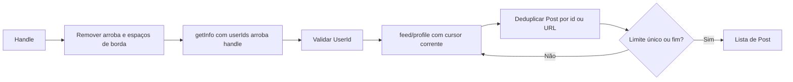

[⬅️ Fluxos](./README.md) · [🏠 Índice](../README.md)

# 🔀 Fluxo — Postagens de perfil

> **Resumo:** normalizar handle, resolver id numérico e percorrer páginas móveis
> até limite de posts únicos ou fim informado.

## Etapas

1. **Normalizar:** `normalize_handle` prepara o `Handle`; entrada inválida aborta.
2. **Resolver:** `MobileApiAdapter.resolve_user` usa `getInfo` com contexto
   completo, `userIds=@handle`, assinatura local e a escada de gateways.
3. **Paginar:** `CollectUserPosts` usa `iter_pages` e pede 30 por página;
   `fetch_profile_page` usa o contexto mínimo validado do feed.
4. **Mapear:** o adapter devolve `ProfilePage` com posts e continuação.
5. **Acumular:** dedupe por id/URL; o limite conta posts únicos.
6. **Encerrar:** limite, página mapeada vazia ou sentinela de fim.

Falha de resolução não tem parcial de posts. Falha em página posterior preserva
posts anteriores. Um lote de feeds todos ignorados pelo mapper é página vazia
para a aplicação, mesmo que o payload cru tenha itens.

Não há SSR, Nuxt ou fallback web. O contexto completo também funcionou no app
observado; o mínimo não é documentado como exigência universal do servidor.

O comando `profile` usa `CollectProfileBundle`: entrega primeiro os posts,
depois as versões solicitadas de comentários de cada postagem. As raízes são
buscadas uma vez por postagem e respostas só com `--with-comments-replies`.
`--limit` controla posts; `--comments-limit` controla raízes cruas por postagem.
Falha individual não impede as outras; parcial de posts ainda pode ser
enriquecido. Layout e códigos de saída estão em [CLI](../guides/cli.md).

## Regras envolvidas

[RN-001, RN-003 a RN-005 — fonte, limite, dedupe e fim](../business-rules/collection.md) ·
[RN-007 a RN-009 — dados](../business-rules/data-contract.md) ·
[RN-011 e RN-013 — falhas](../business-rules/failure-policy.md).

## Referências

[UC-002](../use-cases/uc-002-collect-user-posts.md) ·
[Paginação](./pagination.md) · [ADR móvel](../adr/0001-mobile-profile-and-comments.md).

Verificação: `tests/test_usecases.py`, `tests/test_mobile_api.py`, `tests/test_collector.py`.
