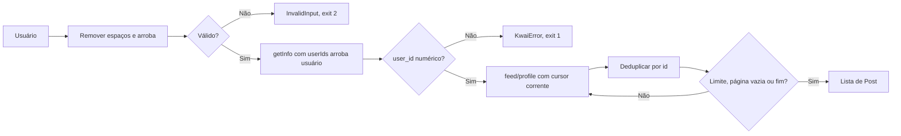

[⬅️ Fluxos](./README.md) · [🏠 Índice](../README.md)

# 🔀 Fluxo — Postagens de perfil

> **Resumo:** normalizar o usuário, resolver o id numérico e percorrer as
> páginas móveis até o limite de posts únicos ou o fim informado pela API.

## Etapas

1. **Normalizar:** `get_user_posts` aplica `strip`, remove `@` do início e
   aplica `strip` de novo. Vazio ou com espaço, `/` ou `@` levanta
   `InvalidInput`.
2. **Resolver:** `get_user_id` chama `getInfo` com contexto completo,
   `userIds=@usuário` e assinatura. Usa o primeiro usuário da resposta; sem
   `user_id` numérico, levanta `KwaiError`.
3. **Paginar:** o feed é pedido com query mínima (`kpn`, `appver`), 30 itens
   por página, `privacy=public` e `lang=en`.
4. **Converter:** `parse_posts` transforma cada feed em `Post`.
5. **Acumular:** posts com `id` já visto são pulados. Ao atingir o limite, a
   função devolve na hora.
6. **Encerrar:** página convertida vazia, sentinela de fim ou cursor repetido.

Falha na resolução ou em qualquer página descarta tudo (exit `1`). Uma página
em que todos os feeds foram ignorados pelo parser conta como vazia e encerra a
coleta, mesmo que o JSON cru tivesse itens.

Não há fallback para a web nem para outro contexto. O contexto completo também
já funcionou no app; usar o mínimo no feed não é uma exigência comprovada do
servidor.

Volume observado: um perfil com 7.389 posts foi coletado inteiro em cerca de
seis minutos, com o intervalo padrão de 1,5 s (mais de 240 páginas).

## Regras envolvidas

[RN-001, RN-003, RN-005 e RN-006 — fonte, limite, dedupe e fim](../business-rules/collection.md) ·
[RN-008 a RN-010 — dados](../business-rules/data-contract.md) ·
[RN-012 a RN-015 — falhas](../business-rules/failure-policy.md).

## Referências

[UC-002](../use-cases/uc-002-collect-user-posts.md) · [Paginação](./pagination.md) ·
[Protocolo móvel](../internals/mobile-api.md#feedprofile) ·
[ADR-0001](../adr/0001-mobile-profile-and-comments.md).

Verificação: `tests/test_cli.py` (`test_profile`).
