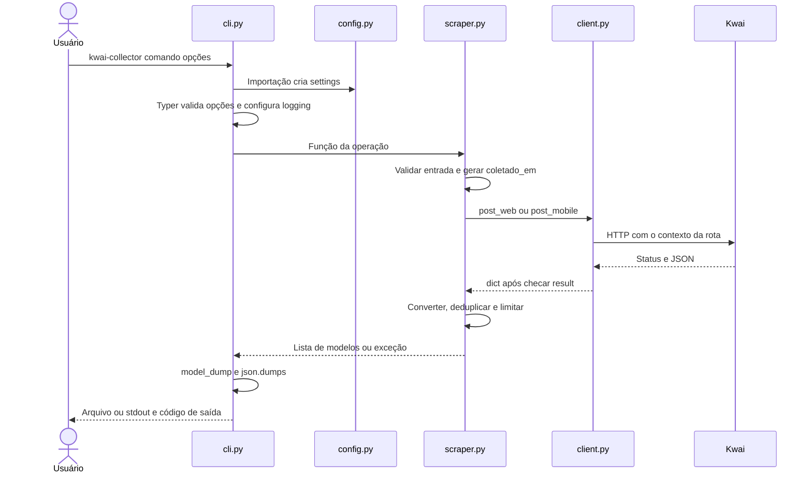

[⬅️ Fluxos](./README.md) · [🏠 Índice](../README.md)

# 🔀 Fluxo — Ciclo de vida

> **Resumo:** receber a entrada na CLI, carregar a configuração, executar a
> coleta inteira em memória, serializar o JSON e sinalizar o resultado pelo
> código de saída.

## Etapas

1. **Configurar:** importar o pacote cria `settings` a partir do `.env` e das
   variáveis `KWAI_`. Valor inválido encerra com traceback (exit `1`) antes de
   qualquer comando. Responsável: [`config.py`](../../kwai_collector/config.py).
2. **Ler argumentos:** o Typer valida opções obrigatórias e `--limit >= 1`;
   erro aqui sai com `2`. `setup_logging` configura o nível. Responsável:
   [`cli.py`](../../kwai_collector/cli.py).
3. **Coletar:** a função do scraper valida a entrada, gera um `coletado_em`
   para a execução inteira e faz as requisições. Responsável:
   [`scraper.py`](../../kwai_collector/scraper.py).
4. **Tratar exceção:** `InvalidInput` vira exit `2`; `KwaiError` vira exit `1`.
   Nos dois casos, nada é gravado.
5. **Serializar:** `model_dump()` em cada item e `json.dumps` com
   `ensure_ascii=False` e indentação 2.
6. **Entregar:** com `--out`, cria as pastas e grava em UTF-8 (falha de escrita
   sai com `1`); sem `--out`, imprime no stdout.

`coletado_em` representa a execução, não cada página nem a data do conteúdo.
Não há recursos para fechar: cada requisição abre e fecha a própria conexão.

## Regras envolvidas

[RN-001 — fontes](../business-rules/collection.md#rn-001--fonte-por-operação) ·
[RN-008 a RN-010 — contrato e datas](../business-rules/data-contract.md) ·
[RN-012, RN-015 e RN-016 — entrada, tudo ou nada e saída](../business-rules/failure-policy.md).

## Referências

[Referência Python](../reference/api-reference.md) ·
[Arquitetura](../internals/architecture.md) ·
[ADR-0004 — Saída tudo ou nada](../adr/0004-all-or-nothing-output.md).

Verificação: `tests/test_cli.py`.
