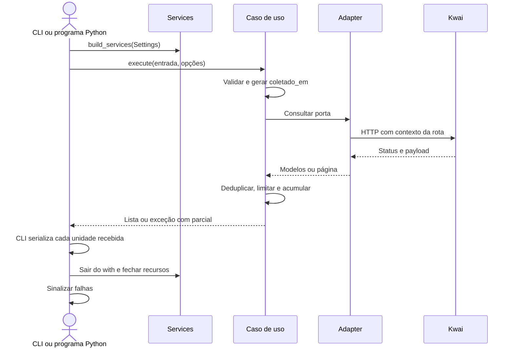

[⬅️ Fluxos](./README.md) · [🏠 Índice](../README.md)

# 🔀 Fluxo — Ciclo de vida

> **Resumo:** receber a entrada na CLI ou em Python, compor serviços, executar
> coleta, persistir as unidades e encerrar recursos.

## Etapas

1. **Configurar:** `src/config/settings.py` carrega `Settings`; a CLI trata configuração inválida.
2. **Compor:** `src/infrastructure/container/container.py` cria clientes web e móvel, mesmo se só um
   comando for usado. O móvel é compartilhado por perfil e comentários.
3. **Executar:** casos de uso validam entrada, geram carimbo comum e consultam portas.
4. **Persistir:** a CLI escreve cada lista normal ou tenta escrever `partial`
   antes de fechar os clientes. Um chamador Python define sua própria persistência.
5. **Fechar:** `Services.__exit__` chama `close()`; `ExitStack` tenta fechar os
   dois recursos. Erros de fechamento não são engolidos e podem afetar a cadeia de erro.
6. **Sinalizar:** a CLI termina com o código de saída correspondente.

`coletado_em` representa uma execução, não cada página ou a publicação do conteúdo.
Dados ficam em memória por unidade. A CLI nova grava posts e cada versão por
postagem durante a execução; não escreve a cada página nem salva checkpoint.
`CollectProfileBundle` isola falhas entre postagens. Consulte [CLI](../guides/cli.md).

## Regras envolvidas

[RN-001 — fontes](../business-rules/collection.md#rn-001--fonte-por-operação) ·
[RN-007 a RN-009 — contrato e datas](../business-rules/data-contract.md) ·
[RN-013 e RN-015 — parcial e saída](../business-rules/failure-policy.md).

## Referências

[API Python](../reference/api-reference.md) · [Arquitetura](../internals/architecture.md) ·
[ADR de parcial](../adr/0004-partial-results-and-declared-counts.md).

Verificação: `tests/integration/test_collector.py`, `tests/integration/test_cli.py`, `tests/integration/test_cli_exports.py`.
Esta última simula falha de fechamento após a persistência da CLI nova.
