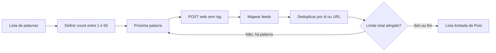

[⬅️ Fluxos](./README.md) · [🏠 Índice](../README.md)

# 🔀 Fluxo — Busca de postagens

> **Resumo:** consultar palavras-chave sequencialmente, mapear feeds e entregar
> uma lista deduplicada com limite total.

## Etapas

1. **Validar e preparar:** `SearchPosts.execute` rejeita lista vazia; calcula
   `count` uma vez a partir do limite total, não do saldo entre palavras.
2. **Consultar:** `KwaiWebAdapter` envia JSON para
   `/rest/o/w/pwa/v2/search/word/outer`, com retry de transporte selecionado.
3. **Mapear:** `parse_feeds` aplica o contrato e a política de itens de feed.
4. **Deduplicar:** `SearchPosts` conserva a primeira ocorrência por id truthy ou URL.
5. **Parar:** ao atingir o limite, não consulta palavras restantes; fatia o resultado ao teto.
6. **Falhar:** erro de uma palavra posterior preserva itens das anteriores em parcial.

O corpo contém `pcursor=0`, mas o caso de uso não pagina. Limite maior que 50
não cria páginas adicionais da mesma palavra.

## Regras envolvidas

[RN-001, RN-002 e RN-004 — fonte, limite e identidade](../business-rules/collection.md) ·
[RN-008 — conversão](../business-rules/data-contract.md#rn-008--desconhecido-não-é-zero) ·
[RN-011 e RN-013 — retry e parcial](../business-rules/failure-policy.md).

## Referências

[UC-001](../use-cases/uc-001-search-posts.md) · [Schemas](../reference/schemas.md) ·
[Protocolo e resiliência](../internals/mobile-api.md).

Verificação: `tests/unit/test_usecases.py`, `tests/integration/test_collector.py`.
