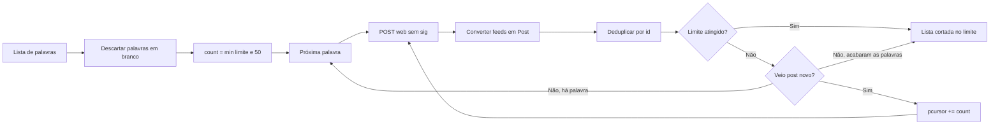

[⬅️ Fluxos](./README.md) · [🏠 Índice](../README.md)

# 🔀 Fluxo — Busca de postagens

> **Resumo:** paginar cada palavra-chave em sequência, converter os feeds e
> entregar uma lista deduplicada com limite total.

## Etapas

1. **Validar:** `search_posts` remove espaços das bordas e descarta palavras
   vazias. Sem nenhuma, levanta `InvalidInput` (exit `2`).
2. **Preparar:** calcula `count = min(limit, 50)` uma vez; é o tamanho de cada
   página.
3. **Consultar:** `post_web` envia JSON para
   `/rest/o/w/pwa/v2/search/word/outer` com `searchWord`, `count`,
   `fromUser=false`, `mobile=true`, `pcursor`, `request_source=1102` e
   `url=https://www.kwai.com/discover`. O `pcursor` começa em `0` e avança
   `count` a cada página. Retry em falha passageira.
4. **Converter:** `parse_posts` aplica o mapeamento de feeds e ignora os que não
   permitem montar a URL.
5. **Deduplicar:** conserva a primeira ocorrência de cada `id`.
6. **Paginar:** se a página trouxe ao menos um post novo e o limite não foi
   atingido, pede a próxima página da mesma palavra. Sem post novo, passa para
   a próxima palavra.
7. **Parar:** quando o total atinge o limite, não pede mais páginas nem
   consulta as palavras restantes. Devolve a lista cortada no limite.
8. **Falhar:** um erro em qualquer palavra interrompe tudo; as postagens das
   palavras anteriores são descartadas (exit `1`).

A API não devolve cursor de continuação nem lista vazia: quando a palavra se
esgota, ela repete itens já entregues. Por isso o fim de cada palavra é a
primeira página sem post novo.

## Regras envolvidas

[RN-001, RN-002 e RN-005 — fonte, limite e identidade](../business-rules/collection.md) ·
[RN-009 — conversão](../business-rules/data-contract.md#rn-009--desconhecido-não-é-zero) ·
[RN-013 e RN-015 — retry e tudo ou nada](../business-rules/failure-policy.md).

## Referências

[UC-001](../use-cases/uc-001-search-posts.md) · [Schemas](../reference/schemas.md) ·
[Protocolo e retry](../internals/mobile-api.md#retry-ritmo-e-custo).

Verificação: `tests/test_cli.py` (`test_search`,
`test_search_pagina_ate_nao_vir_post_novo`, `test_erro_de_rede_sai_com_1`).
