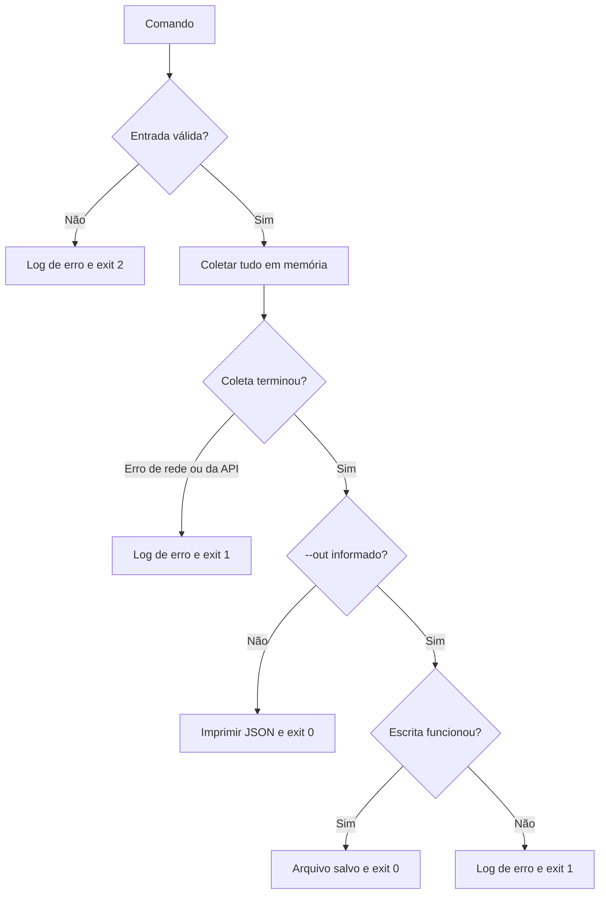

[🏠 Índice](../README.md)

# CLI

Os comandos são `search`, `profile` e `comments`. Opções e ajuda estão em
inglês; os campos do JSON continuam em português, conforme o schema do desafio.
Os exemplos fazem rede. Para instalar e configurar, veja
[Primeiros passos](./getting-started.md).

## Comandos por objetivo

Todos os exemplos desta seção podem ser copiados como uma única linha no
PowerShell ou em shell POSIX. Substitua `parkourcity` ou a URL pelo alvo desejado.

### 1. Postagens de um perfil

```bash
poetry run kwai-collector profile --user parkourcity --limit 10 --out out/usuario.json
```

Grava até dez posts únicos em `out/usuario.json`. O usuário pode vir com ou sem
`@`. Não consulta comentários.

Sem `--limit`, coleta o perfil inteiro até a API indicar o fim. Em uma execução
de verificação, um perfil com 7.389 posts levou cerca de seis minutos com o
intervalo padrão de 1,5 s entre requisições.

### 2. Buscar postagens por palavra-chave

```bash
poetry run kwai-collector search --keyword parkour --keyword sports --limit 20 --out out/busca.json
```

`--keyword` pode ser repetido. O limite é de até vinte posts únicos no
resultado total, não vinte por palavra. As palavras são consultadas na ordem
informada; quando o limite é atingido, as restantes não são consultadas.

Cada palavra é paginada de 50 em 50 até atingir o limite ou até uma página não
trazer nenhum post novo, e só então a próxima palavra é consultada.

### 3. Comentários de uma postagem

```bash
poetry run kwai-collector comments --url "https://www.kwai.com/@parkourcity/video/5240651225143682227" --out out/comentarios.json
```

Coleta todos os comentários principais do post. Um comentário **principal**
(ou raiz) é um comentário direto da postagem, não uma resposta a outro
comentário. Para pegar só os primeiros:

```bash
poetry run kwai-collector comments --url "https://www.kwai.com/@parkourcity/video/5240651225143682227" --limit 50 --out out/comentarios.json
```

A URL precisa conter `/video/<id>` ou `/photo/<id>`.

### 4. Comentários e respostas

```bash
poetry run kwai-collector comments --url "https://www.kwai.com/@parkourcity/video/5240651225143682227" --limit 50 --with-replies --out out/comentarios.json
```

A saída vira uma lista plana: cada comentário principal seguido das respostas
dele. `--limit 50` conta só os comentários principais; as respostas desses 50
vêm junto e não consomem o limite. Pode haver bem mais de 50 itens no arquivo.

Em uma verificação com `--limit 3 --with-replies`, o arquivo teve 71 itens:
3 comentários principais e 68 respostas.

## Opções e ajuda

```bash
poetry run kwai-collector --help
poetry run kwai-collector search --help
poetry run kwai-collector profile --help
poetry run kwai-collector comments --help
```

| Opção | Comandos | Efeito |
|---|---|---|
| `--keyword/-k` | `search` | Palavra-chave; repita a opção para várias. Obrigatória. |
| `--user/-u` | `profile` | Usuário com ou sem `@`. Obrigatória. |
| `--url` | `comments` | Link de uma postagem. Obrigatória. |
| `--limit/-l` | todos | Posts únicos em `search`/`profile`; comentários principais únicos em `comments`. Mínimo 1. |
| `--with-replies` | `comments` | Inclui as respostas de cada comentário principal. |
| `--out/-o` | todos | Arquivo JSON de saída. Sem ela, o JSON vai para o terminal. |
| `--verbose/-v` | todos | Logs em `DEBUG`, incluindo as requisições do HTTPX. |

O padrão de `--limit` é 20 em `search`. Em `profile` e `comments` não há teto
por padrão. Use limites pequenos ao começar: a expansão de respostas pode
multiplicar chamadas e volume de dados.

## Destino da saída

`--out` recebe o **caminho de um arquivo**. As pastas do caminho são criadas
automaticamente e o arquivo existente é sobrescrito:

```powershell
poetry run kwai-collector profile --user parkourcity --limit 10 --out "D:\Coletas\parkourcity.json"
```

Sem `--out`, o JSON sai no stdout e os logs saem no stderr. Por isso dá para
redirecionar só o JSON:

```bash
poetry run kwai-collector search -k sports -l 5 > busca.json
```

No Windows PowerShell 5.1, o operador `>` grava em UTF-16. Prefira `--out`
para garantir um arquivo UTF-8.

O conteúdo é sempre uma lista JSON, com indentação de dois espaços e Unicode
preservado (`ensure_ascii=False`):

| Comando | Itens da lista |
|---|---|
| `search`, `profile` | `Postagem` |
| `comments` | `Comentario` |
| `comments --with-replies` | `Comentario` com os campos extras `parent_id`, `reply_to_id`, `reply_to_usuario` e `respostas_total` |

Os campos estão detalhados em [Schemas](../reference/schemas.md). Há um exemplo
de cada comando em [`samples/`](../../samples).

## Falhas e códigos de saída



| Código | Situação |
|---|---|
| `0` | Coleta concluída e JSON entregue (arquivo ou terminal). |
| `1` | Erro de rede, da API (`result` diferente de 1), usuário não encontrado ou falha ao gravar o arquivo. |
| `2` | Usuário inválido, URL sem id, nenhuma palavra-chave válida ou opção rejeitada pela CLI (ex.: `--limit 0`). |

- A entrada é validada antes de qualquer requisição.
- Não existe resultado parcial: se a coleta falhar na página 10, as nove
  páginas anteriores são descartadas e nenhum arquivo é escrito.
- Um arquivo que já existia no destino continua intacto quando a coleta falha,
  porque a escrita só acontece no fim.
- Um post que não existe costuma devolver `[]` com exit `0`: a API responde
  sucesso com a lista vazia.
- Exit `0` indica conclusão sem erro, não completude de todo o conteúdo da
  plataforma.

Confira o código logo após o comando. No PowerShell:

```powershell
$LASTEXITCODE
```

Em shell POSIX:

```bash
echo $?
```

Verificação offline: [`tests/test_cli.py`](../../tests/test_cli.py), com HTTP
simulado por `respx`. Detalhes das políticas em
[Falhas e saída](../business-rules/failure-policy.md).
