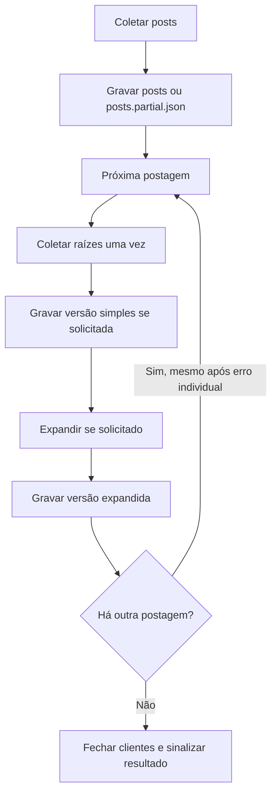

[🏠 Índice](../README.md)

# CLI e exportação organizada

Os comandos recomendados são `search`, `profile` e `comments`. Opções e ajuda
estão em inglês; os campos dos JSON continuam em português, sem mudar o schema.
Os exemplos fazem rede. Para instalar/configurar, veja [Primeiros passos](./getting-started.md).

## Comandos por objetivo

Todos os exemplos desta seção podem ser copiados como uma única linha no
PowerShell ou em shell POSIX. Substitua `parkourcity` ou a URL pelo alvo desejado.
Se ainda não instalou o projeto, comece por [Primeiros passos](./getting-started.md).

### 1. Só postagens de um perfil

```bash
poetry run kwai-collector profile --user parkourcity --limit 10
```

Gera `posts.json` com até dez posts únicos. Não consulta comentários.

### 2. Postagens e comentários, sem respostas

```bash
poetry run kwai-collector profile --user parkourcity --limit 10 --with-comments
```

Gera `posts.json` e `comments/<post-id>.json` para cada postagem coletada.
Um comentário **raiz** é um comentário direto da postagem, não uma resposta a outro comentário.

### 3. Postagens, comentários e respostas

```bash
poetry run kwai-collector profile --user parkourcity --limit 10 --with-comments-replies --comments-limit 50
```

Gera `posts.json` e `comments-replies/<post-id>.json`, com raízes e respostas
juntas. Não gera a versão simples em `comments/`.

Nesse exemplo, `--limit 10` conta posts; `--comments-limit 50` conta raízes
cruas **por postagem**, antes do dedupe. As respostas dessas raízes não consomem
nenhum desses dois limites. Pode haver mais de 50 itens no JSON expandido.

### 4. Guardar as duas versões dos comentários

```bash
poetry run kwai-collector profile --user parkourcity --limit 10 --with-comments --with-comments-replies
```

Gera `posts.json`, `comments/<post-id>.json` e `comments-replies/<post-id>.json`.
As raízes são consultadas uma vez e reaproveitadas entre as versões.

### 5. Buscar postagens por palavra-chave

```bash
poetry run kwai-collector search --keyword parkour --keyword sports --limit 20
```

`--keyword` pode ser repetido. O limite é de até vinte posts únicos no resultado
total, não vinte por palavra. Esse comando não coleta comentários nem pagina
por cursor; gera `exports/search/<execução>/posts.json`.

### 6. Comentários de uma única postagem

```bash
poetry run kwai-collector comments --url "https://www.kwai.com/@parkourcity/video/5240651225143682227" --limit 50
```

Gera `comments/<post-id>.json`, sem buscar os posts do perfil. Para incluir respostas:

```bash
poetry run kwai-collector comments --url "https://www.kwai.com/@parkourcity/video/5240651225143682227" --limit 50 --with-comments-replies
```

Gera `comments-replies/<post-id>.json`. Em `comments`, `--limit` controla raízes
cruas da postagem, não quantidade de respostas; não existe `--comments-limit`.

### 7. Ordenar posts por likes, comentários, compartilhamentos ou visualizações

Escolha **uma contagem** com `--sort-by`; o maior valor vem primeiro:

```bash
poetry run kwai-collector profile --user parkourcity --limit 100 --sort-by likes
poetry run kwai-collector profile --user parkourcity --limit 100 --sort-by comments
poetry run kwai-collector search --keyword parkour --limit 20 --sort-by shares
poetry run kwai-collector search --keyword sports --limit 20 --sort-by views
```

| Valor | Campo no JSON |
|---|---|
| `likes` | `engajamento.curtidas` |
| `comments` | `engajamento.comentarios` |
| `shares` | `engajamento.compartilhamentos` |
| `views` | `engajamento.visualizacoes` |

A opção ordena `posts.json` (ou `posts.partial.json`), sem remover posts ou somar
métricas. Sem a opção, a ordem de coleta permanece. Empates preservam essa ordem;
contagens desconhecidas (`null`) ficam no fim, sem serem convertidas em zero.

**O limite vem antes da ordenação:** com `--limit 100`, ordena os até cem posts
obtidos, não procura os cem mais populares de todo o perfil. A opção não altera
a ordem solicitada ao servidor nem aumenta a coleta. Em `profile`, pode ser
combinada com as opções de comentários: o processamento das postagens segue a
ordem escolhida, mas comentários/respostas dentro de cada arquivo não são reordenados.
Não há `--sort-by` em `comments`.

## Opções e ajuda

```bash
poetry run kwai-collector --help
poetry run kwai-collector profile --help
poetry run kwai-collector search --help
poetry run kwai-collector comments --help
```

| Opção | Efeito |
|---|---|
| `--user/-u` | Handle com ou sem `@`, em `profile`. |
| `--keyword/-k` | Palavra-chave repetível, em `search`. |
| `--url` | Link de uma postagem, em `comments`. |
| `--limit/-l` | Posts únicos em `profile`/`search`; raízes cruas em `comments`. |
| `--sort-by` | `likes`, `comments`, `shares` ou `views`, em `profile`/`search`; ordem decrescente após o limite. |
| `--comments-limit` | Raízes cruas **por postagem**, em `profile`. Repetidas também consomem esse teto. |
| `--with-comments` | Gera somente a versão simples de comentários, em `profile`. |
| `--with-comments-replies` | Gera versão expandida; sozinha não gera a versão simples. |
| `--out/-o` | Pasta-base opcional, padrão `exports/` no diretório de execução. |
| `--verbose/-v` | Logs DEBUG. |

Limites exigem pelo menos 1. Busca tem padrão 20 e não pagina por cursor;
perfil e comentários não têm teto explícito por padrão. Use limites pequenos
ao começar: expansão de respostas pode multiplicar chamadas e volume de dados.

## Destino e versões

Sem `--out`, os diretórios são criados automaticamente. Para escolher outra base:

```powershell
poetry run kwai-collector profile --user parkourcity --limit 10 --with-comments-replies --out "D:\Coletas"
```

Nesse caso, os arquivos ficam em `D:\Coletas\parkourcity\<execução>\`.
`--out` é **pasta**, não nome de arquivo; não passe `resultado.json` esperando
um JSON único. O terminal mostra `Export directory: ...` para localizar a saída.

```text
exports/                       # ou D:\Coletas, se indicado
└── parkourcity/
    └── <data-hora-UTC>-<identificador>/
        ├── posts.json
        ├── comments/          # somente quando solicitada a versão simples
        │   └── <post-id>.json
        └── comments-replies/  # somente quando solicitada a versão expandida
            └── <post-id>.json
```

O arquivo simples contém raízes `Comment`. O expandido contém novamente as
raízes, seguidas das respostas, numa lista plana de `ExpandedComment`, com
`parent_id` e `reply_to_*`. Não existe pasta exclusiva de respostas.
`posts.json` é uma lista única; os comentários têm um arquivo por postagem.

`search` usa `exports/search/<execução>/posts.json`: uma busca pode reunir vários
perfis. `comments` usa o handle presente no caminho da URL ou `post-<id>` se não
houver handle, sem gerar `posts.json`. Nomes incompatíveis com o filesystem são
normalizados com sufixo de identificação. Cada execução cria pasta exclusiva,
sem reutilizar ou sobrescrever a execução anterior.

## Falhas e parciais



- Resultados são gravados por unidade antes de fechar os clientes, não a cada
  página HTTP. Não há checkpoint nem retomada.
- Falha de uma postagem ou arquivo não impede as demais. Logs identificam a
  etapa e a URL; qualquer falha tratada produz exit `1`.
- Parcial usa `.partial.json`, por exemplo `posts.partial.json` ou
  `comments-replies/123.partial.json`. Não há envelope ou `report.json`.
- Se as raízes falharem, preservar o parcial em `comments/<id>.partial.json`,
  **mesmo se só foi pedida expansão**. Não começar respostas nem publicar esse
  dado como versão expandida.
- Se respostas falharem, manter a versão simples já concluída, quando solicitada,
  e a versão expandida parcial. Dentro dessa postagem, raízes pendentes continuam
  preservadas, mas suas respostas não são tentadas após a interrupção.
- Posts parcialmente obtidos ainda podem ter comentários coletados; o arquivo
  de posts permanece marcado como parcial.
- Falha sem itens não publica JSON daquela unidade; pode deixar a pasta da execução.
  Sucesso vazio publica `[]`.
- Cada JSON é escrito em temporário e publicado por rename; uma falha não deve
  expor um JSON truncado no nome final. Não há transação do conjunto de arquivos.
- Falha no fechamento sinaliza erro e não remove arquivos já publicados.

Exit `0` indica conclusão sem erro tratado, não completude de todo o conteúdo
da plataforma. Warnings de contagens divergentes não mudam o exit code sozinhos.
Exit `2` indica argumento ou alvo inválido.

Confira o código imediatamente após o comando. No PowerShell:

```powershell
$LASTEXITCODE
```

Em shell POSIX:

```bash
echo $?
```

Verificação offline: `tests/test_cli_exports.py`, com HTTP simulado, diretórios
temporários e falhas de coleta, publicação de arquivos e fechamento.
