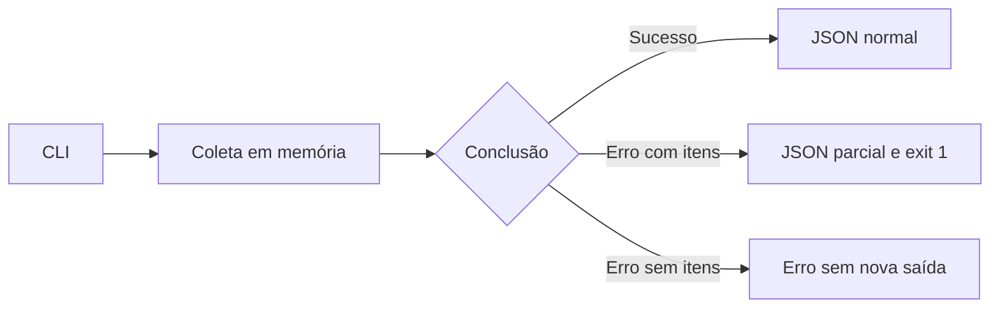

[🏠 Índice](../README.md)

# Primeiros passos

Siga este guia para instalar, coletar poucos posts e abrir o JSON. Depois,
use a [referência da CLI](./cli.md#comandos-por-objetivo) para escolher outras
coletas. Os comandos abaixo podem ser copiados no PowerShell ou em shell POSIX.

## Requisitos e o que não é necessário

| Item | Finalidade |
|---|---|
| Python 3.11+ | Executar o pacote; a restrição declarada é `^3.11`. |
| Poetry | Instalar dependências e executar o script `kwai-collector`. |
| Rede e HTTPS | Acessar os hosts do Kwai nos comandos de coleta. |
| Acesso de escrita | A CLI nova cria `exports/` por padrão, ou a pasta-base em `--out`. |

Não configure uma conta, senha, cookie ou chave de serviço pago. O `client_key`
do protocolo móvel é uma constante da identidade do app, não uma credencial que
o usuário precisa contratar. Veja [Assinatura](../internals/signature.md).

Frida, ADB, APKs e emuladores pertencem à investigação de compatibilidade,
quando necessária. Não são dependências de execução deste pacote.

## 1. Instalar e conferir a CLI

Execute na raiz do repositório:

```bash
poetry install
poetry run kwai-collector --help
```

O pacote está configurado em [`pyproject.toml`](../../pyproject.toml); não há promessa
de publicação no PyPI nem instrução de instalar um pacote homônimo de terceiros.
[`poetry.lock`](../../poetry.lock) registra a resolução de dependências.

Não precisa criar `.env` para começar. Na ajuda aparecem `profile`, `search`
e `comments`: prefira esses comandos em inglês. Os nomes em português são
compatibilidade para scripts antigos e têm outra semântica de saída.

## 2. Fazer a primeira coleta e abrir o resultado

Troque `parkourcity` pelo perfil público que deseja coletar:

```bash
poetry run kwai-collector profile --user parkourcity --limit 3
```

Esse comando pede até três postagens únicas, **sem comentários**, e grava uma
lista JSON. O terminal informa a pasta no formato:

```text
Export directory: exports/parkourcity/<execução>
```

Abra `posts.json` dentro dessa pasta no editor de sua preferência. A pasta
`exports/` é criada automaticamente onde você executou o comando. Cada nova
execução tem outra subpasta; os resultados anteriores não são sobrescritos.

Confira os logs e o código de saída: `0` indica conclusão sem erro tratado.
Uma lista `[]` significa que nenhum post foi entregue nesse resultado; não é
prova de defeito nem de ausência de posts na plataforma. Os exemplos fazem rede
e dependem da disponibilidade da API.

## 3. Escolher outra coleta

Os exemplos abaixo fazem rede e usam alvos que podem mudar. Um perfil de exemplo
não é uma fixture nem garantia de conteúdo disponível.

```bash
poetry run kwai-collector search -k sports -k parkour -l 5
poetry run kwai-collector profile -u @parkourcity -l 5
poetry run kwai-collector profile -u @parkourcity -l 5 --with-comments --comments-limit 10
poetry run kwai-collector profile -u @parkourcity -l 5 --with-comments-replies --comments-limit 10
poetry run kwai-collector comments --url "https://www.kwai.com/@parkourcity/video/5240651225143682227" -l 5 --with-comments-replies
```

| Comando | Entrada | Padrão de limite | O que o limite conta |
|---|---|---|---|
| `search` | `--keyword/-k`, repetível | 20 | Postagens únicas no resultado total, entre palavras-chave. |
| `profile` | `--user/-u` | Sem teto explícito | Postagens únicas do perfil; `--comments-limit` controla raízes por postagem. |
| `comments` | `--url` | Sem teto explícito | Raízes cruas recebidas, antes de deduplicar. Respostas não consomem esse teto. |

`--limit/-l` na CLI exige pelo menos 1. Sem teto explícito, o comando continua até
as condições de fim da [paginação](../flows/pagination.md); isso não equivale a completude.
`--verbose/-v` aumenta o logging para `DEBUG`. Sem `--out/-o`, a CLI nova salva
em `exports/`; com ele, usa a pasta-base escolhida. Exemplos completos,
e organização dos arquivos estão em [CLI](./cli.md).

Não confunda `--limit` com tamanho de página: a busca pede de 1 a 50 por palavra,
perfil pede 30, raízes pedem 50 e sublistas pedem 100.

## Saída e falhas



| Código | Leitura operacional |
|---|---|
| `0` | O comando concluiu; verifique contagem e warnings antes de afirmar completude. |
| `1` | Falha de execução tratada; a saída pode ser parcial. |
| `2` | Entrada inválida reconhecida ou argumentos rejeitados pela CLI. |

A escrita é UTF-8, com indentação de dois espaços e Unicode preservado.
Cada execução cria pasta exclusiva. JSON é publicado por
rename de temporário e parciais usam `.partial.json`. Falha de uma postagem ou
arquivo não impede as demais; o comando sai com `1` se houve qualquer falha.
Não há transação de todos os arquivos, checkpoint ou retomada.

## Se algo impedir o primeiro uso

| Sintoma | O que conferir |
|---|---|
| `poetry` não é reconhecido | Instalação do [Poetry](https://python-poetry.org/) e disponibilidade no PATH. |
| Poetry não encontra `pyproject.toml` | Execute na raiz deste repositório, não dentro de `docs/` ou `src/`. |
| Comando ou opção não reconhecidos | Veja `poetry run kwai-collector profile --help`; opções estão em inglês. |
| Não encontrei o arquivo | Leia `Export directory:` e procure a execução mais recente; a base padrão é relativa ao diretório de execução. |
| Erro de coleta ou arquivo `.partial.json` | Confira exit code e logs; siga [Falhas e parciais](./cli.md#falhas-e-parciais). |

## Configuração opcional

Copiar `.env.example` é opcional. No PowerShell:

```powershell
Copy-Item .env.example .env
```

Em shell POSIX:

```bash
cp .env.example .env
```

[`Settings`](../../src/config.py) lê `.env`, variáveis `KWAI_` e parâmetros explícitos
quando instanciado em Python. `.env` é ignorado pelo Git. Os campos desconhecidos
do arquivo são ignorados; isso não cria opções novas no coletor.

| Variável | Campo Python | Padrão | Validação e efeito |
|---|---|---|---|
| `KWAI_REQUEST_DELAY` | `request_delay` | `1.5` | Número ≥ 0; intervalo em segundos por adapter. `0` desliga a espera. |
| `KWAI_HTTP_TIMEOUT` | `http_timeout` | `20.0` | Número > 0; timeout passado ao cliente HTTPX. |
| `KWAI_MAX_RETRIES` | `max_retries` | `3` | Inteiro ≥ 0; tentativas extras. `0` mantém só a tentativa/rodada inicial. |
| `KWAI_USER_AGENT` | `user_agent` | UA de navegador em `DEFAULT_USER_AGENT` | Aplicado apenas à busca web; vazio volta ao padrão. |

`APP_VERSION`, `CLIENT_KEY`, `SIG_SALT` e o UA móvel não são variáveis `KWAI_`.
São constantes em [`app_identity.py`](../../src/infrastructure/app_identity.py).
Não há opções de cookie, proxy dedicado, signer externo ou retomada de cursor.

O timeout numérico do HTTPX cobre esperas de conexão, leitura, escrita e pool;
não é um prazo total da coleta. Retry, várias páginas e vários gateways podem
fazer uma execução durar muito mais que 20 segundos. Referência da biblioteca:
[timeouts do HTTPX](https://www.python-httpx.org/advanced/timeouts/).

Veja [Schemas](../reference/schemas.md), [Referência Python](../reference/api-reference.md) e o
[runbook de manutenção](../maintenance/maintenance.md).
