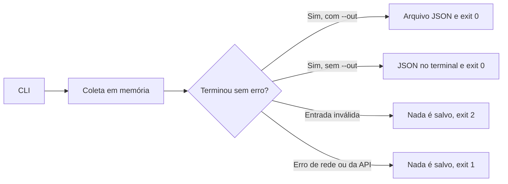

[🏠 Índice](../README.md)

# Primeiros passos

Siga este guia para instalar, coletar poucos posts e abrir o JSON. Depois, use
a [referência da CLI](./cli.md#comandos-por-objetivo) para escolher outras
coletas. Os comandos abaixo podem ser copiados no PowerShell ou em shell POSIX.

## Requisitos e o que não é necessário

| Item | Finalidade |
|---|---|
| Python 3.11+ | Executar o pacote; a restrição declarada é `^3.11`. |
| Poetry | Instalar dependências e executar o script `kwai-collector`. |
| Rede e HTTPS | Acessar os hosts do Kwai nos comandos de coleta. |
| Acesso de escrita | Só quando você usa `--out`: a CLI cria as pastas do caminho informado. |

Não configure conta, senha, cookie ou chave de serviço pago. O `client_key` do
protocolo móvel é uma constante da identidade do app, não uma credencial que o
usuário precisa contratar. Veja [Assinatura](../internals/signature.md).

Frida, ADB, APKs e emuladores pertencem à investigação de compatibilidade,
quando ela for necessária. Não são dependências de execução deste pacote.

## 1. Instalar e conferir a CLI

Execute na raiz do repositório:

```bash
poetry install
poetry run kwai-collector --help
```

O pacote está configurado em [`pyproject.toml`](../../pyproject.toml); não há
promessa de publicação no PyPI. [`poetry.lock`](../../poetry.lock) registra a
resolução das dependências. Também funciona como módulo:

```bash
poetry run python -m kwai_collector --help
```

Não precisa criar `.env` para começar. A ajuda lista três comandos: `search`,
`profile` e `comments`.

## 2. Fazer a primeira coleta e abrir o resultado

Troque `parkourcity` pelo perfil público que deseja coletar:

```bash
poetry run kwai-collector profile --user parkourcity --limit 3 --out out/usuario.json
```

Esse comando pede até três postagens únicas e grava uma lista JSON em
`out/usuario.json`. A pasta `out/` é criada no diretório onde você executou o
comando. O log informa o resultado no formato:

```text
2026-10-09 18:21:42,013 | INFO | 3 itens salvos em out/usuario.json
```

Abra o arquivo no editor de sua preferência. Executar de novo com o mesmo
`--out` **sobrescreve** o arquivo anterior.

Sem `--out`, o JSON é impresso no terminal (stdout) e os logs vão para stderr:

```bash
poetry run kwai-collector profile --user parkourcity --limit 3
```

Confira os logs e o código de saída: `0` indica conclusão sem erro. Uma lista
`[]` significa que nenhum item foi entregue; não é prova de defeito nem de
ausência de conteúdo na plataforma. Os exemplos fazem rede e dependem da
disponibilidade da API.

## 3. Escolher outra coleta

Os exemplos abaixo fazem rede e usam alvos que podem mudar. Um perfil de
exemplo não é fixture nem garantia de conteúdo disponível.

```bash
poetry run kwai-collector search -k sports -k parkour -l 5
poetry run kwai-collector profile -u @parkourcity -l 5
poetry run kwai-collector comments --url "https://www.kwai.com/@parkourcity/video/5240651225143682227" -l 5
poetry run kwai-collector comments --url "https://www.kwai.com/@parkourcity/video/5240651225143682227" -l 5 --with-replies
```

| Comando | Entrada | Padrão de limite | O que o limite conta |
|---|---|---|---|
| `search` | `--keyword/-k`, repetível | 20 | Postagens únicas no resultado total, somando as palavras-chave. |
| `profile` | `--user/-u` | Sem teto | Postagens únicas do perfil. |
| `comments` | `--url` | Sem teto | Comentários principais únicos. Respostas não entram nessa conta. |

`--limit/-l` exige pelo menos 1. Sem teto, o comando continua até as condições
de fim da [paginação](../flows/pagination.md); isso não equivale a completude.
`--verbose/-v` aumenta o logging para `DEBUG`. Exemplos completos estão em
[CLI](./cli.md).

Não confunda `--limit` com tamanho de página: a busca pede até 50 por página,
o perfil pede 30 por página, os comentários principais pedem 50 e as respostas
pedem 100.

## Saída e falhas



| Código | Leitura operacional |
|---|---|
| `0` | O comando concluiu; confira a contagem e os warnings antes de afirmar completude. |
| `1` | Falha de rede, da API ou de escrita do arquivo. Nada foi salvo. |
| `2` | Entrada inválida (usuário, URL, palavra-chave ou opção da CLI). |

A escrita é UTF-8, com indentação de dois espaços e Unicode preservado. O
arquivo só é escrito depois que a coleta inteira termina; uma falha no meio
descarta o que já tinha sido coletado. Veja
[ADR-0004](../adr/0004-all-or-nothing-output.md).

## Se algo impedir o primeiro uso

| Sintoma | O que conferir |
|---|---|
| `poetry` não é reconhecido | Instalação do [Poetry](https://python-poetry.org/) e disponibilidade no PATH. |
| Poetry não encontra `pyproject.toml` | Execute na raiz deste repositório, não dentro de `docs/` ou `kwai_collector/`. |
| Comando ou opção não reconhecidos | Veja `poetry run kwai-collector profile --help`; as opções estão em inglês. |
| Não encontrei o arquivo | O caminho de `--out` é relativo ao diretório onde o comando rodou. O log `itens salvos em ...` mostra o caminho usado. |
| Acentos quebrados no terminal | O JSON está correto; é a codificação do console. Prefira `--out` e abra o arquivo no editor. |
| Erro de configuração com traceback | Uma variável `KWAI_` com valor inválido. Veja a tabela de configuração abaixo. |
| Erro de coleta | Confira o código de saída e os logs; siga [Manutenção](../maintenance/maintenance.md). |

## Configuração opcional

Copiar `.env.example` é opcional. No PowerShell:

```powershell
Copy-Item .env.example .env
```

Em shell POSIX:

```bash
cp .env.example .env
```

[`Settings`](../../kwai_collector/config.py) lê o `.env` do diretório atual e as
variáveis de ambiente com prefixo `KWAI_`. O `.env` é ignorado pelo Git. Campos
desconhecidos no arquivo são ignorados; isso não cria opções novas no coletor.

| Variável | Campo Python | Padrão | Validação e efeito |
|---|---|---|---|
| `KWAI_REQUEST_DELAY` | `request_delay` | `1.5` | Número ≥ 0; intervalo mínimo em segundos entre requisições. `0` desliga a espera. |
| `KWAI_HTTP_TIMEOUT` | `http_timeout` | `20.0` | Número > 0; timeout passado ao HTTPX em cada requisição. |
| `KWAI_MAX_RETRIES` | `max_retries` | `3` | Inteiro ≥ 0; tentativas extras em falha passageira. `0` mantém só a tentativa inicial. |
| `KWAI_USER_AGENT` | `user_agent` | UA de navegador Chrome | Aplicado somente à busca web. |

A configuração é lida uma vez, quando o pacote é importado. Um valor inválido
(por exemplo `KWAI_REQUEST_DELAY=abc`) faz o comando terminar com a mensagem de
validação do Pydantic e traceback, com código `1`.

`APP_VERSION`, `CLIENT_KEY`, `SIG_SALT` e o UA móvel não são variáveis `KWAI_`.
São constantes em [`client.py`](../../kwai_collector/client.py). Não há opções de
cookie, proxy, assinador externo ou retomada de cursor.

O timeout numérico do HTTPX cobre conexão, leitura, escrita e pool; não é um
prazo total da coleta. Retry, várias páginas e vários hosts podem fazer uma
execução durar muito mais que 20 segundos. Referência da biblioteca:
[timeouts do HTTPX](https://www.python-httpx.org/advanced/timeouts/).

Veja [Schemas](../reference/schemas.md), [Referência Python](../reference/api-reference.md)
e o [guia de manutenção](../maintenance/maintenance.md).
