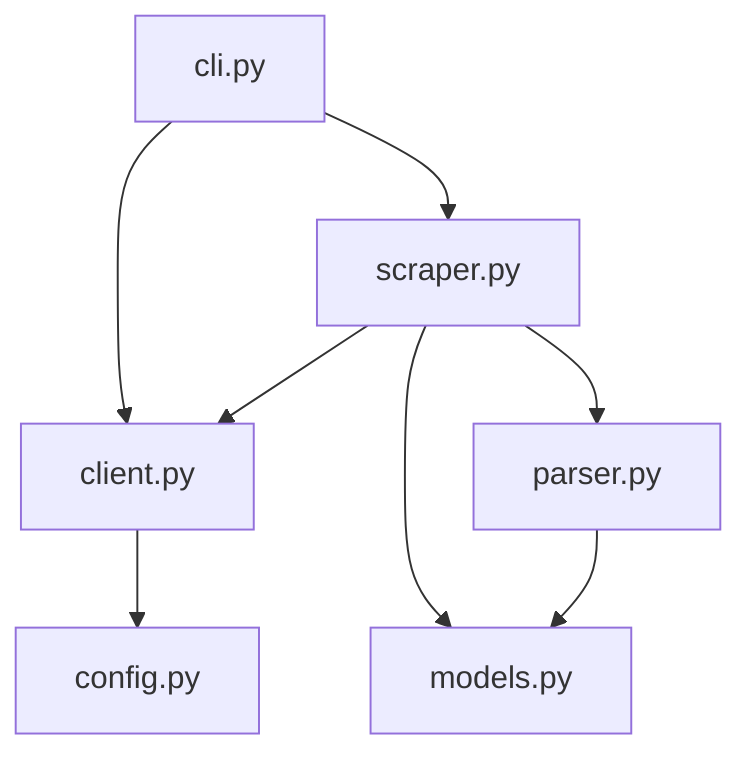
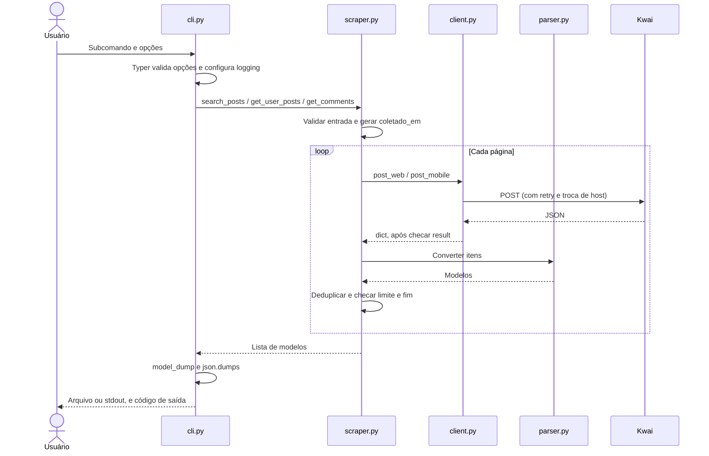

[🏠 Índice](../README.md)

# Arquitetura

## Visão geral

O Kwai Collector é uma aplicação Python síncrona de linha de comando que
coleta postagens por palavra-chave, postagens de um perfil e comentários de uma
postagem. Cada comando gera uma lista JSON, gravada num arquivo ou impressa no
terminal.

O código é organizado em **módulos por responsabilidade**, sem camadas
formais: um módulo faz HTTP, outro converte dados, outro define os modelos,
outro coordena a coleta e outro expõe a CLI. Essa é a separação
client / parser / models / cli que o nível 1 do desafio pede, mantida no menor
tamanho possível. A escolha e o que se perde com ela estão na
[ADR-0003](../adr/0003-flat-modules.md).

Não há banco de dados, fila, servidor web nem objeto de serviço com estado. Os
itens coletados ficam em memória até o fim do comando.

### Stack

| Componente | Uso no projeto |
|---|---|
| Python 3.11+ e Poetry | Runtime, dependências e script `kwai-collector`. |
| Typer | Subcomandos, opções, validação de argumentos e códigos de saída. |
| HTTPX | Requisições HTTP síncronas para a busca web e a API móvel. |
| Pydantic | Modelos de saída validados (`Post`, `Comment`, `CommentWithReplies`). |
| pydantic-settings | Configuração tipada via ambiente e `.env`. |
| Pytest e respx | Testes e simulação do transporte HTTP. |
| Ruff e mypy (strict) | Lint, formatação e análise estática de tipos. |

O retry com backoff é implementado à mão em `client.py`, sem biblioteca
dedicada. As dependências e os comandos de qualidade estão em
[`pyproject.toml`](../../pyproject.toml) e no [README](../../README.md).

## Organização do código

```text
kwai_collector/
├── __init__.py
├── __main__.py     # python -m kwai_collector
├── cli.py          # Comandos Typer, logging, códigos de saída e escrita do JSON
├── scraper.py      # Busca, perfil, comentários e respostas: paginação, limites e dedupe
├── client.py       # HTTP: rate limit, retry, hosts móveis, assinatura sig e checagem de result
├── parser.py       # JSON cru do Kwai → modelos; conversão de números, datas e texto
├── models.py       # Modelos Pydantic de saída (schemas Postagem e Comentario)
└── config.py       # Settings (pydantic-settings) e a instância settings

tests/
├── conftest.py     # Fixtures: zera delay e backoff, limita retries
├── fixtures/       # Respostas reais recortadas da busca e da API móvel
├── test_cli.py     # Os três comandos de ponta a ponta com HTTP simulado
├── test_client.py  # Assinatura, hosts, retry e erros de negócio
├── test_parser.py  # Mapeamento e conversões
└── test_samples.py # samples/ validadas contra os modelos
```

### Responsabilidades e dependências

| Módulo | Responsabilidade | Importa |
|---|---|---|
| `cli.py` | Ler argumentos, configurar logging, chamar o scraper, converter exceções em exit code, serializar e gravar. | `scraper`, `client.KwaiError`, Typer, Pydantic. |
| `scraper.py` | Validar a entrada do usuário, montar o corpo de cada rota, paginar, deduplicar e aplicar limites. | `client`, `parser`, `models`. |
| `client.py` | Fazer o POST, esperar o intervalo, repetir falhas passageiras, trocar de host, assinar e checar `result`. | `config`, HTTPX. |
| `parser.py` | Converter o JSON cru do Kwai nos modelos. | `models`. |
| `models.py` | Definir e validar o contrato de saída. | Pydantic. |
| `config.py` | Ler e validar a configuração. | pydantic-settings. |

As setas abaixo representam dependências de código, não a ordem de execução:



Não há ciclo de imports. `parser.py` e `models.py` não fazem rede e podem ser
testados sem mocks. `scraper.py` conhece as rotas e os corpos do Kwai; trocar
de API exige mexer nele e em `client.py`.

## Ciclo de uma execução

Não há composição de objetos: os módulos expõem funções e a configuração é uma
instância única criada na importação de `config.py`. Cada requisição usa
`httpx.post`, que abre e fecha a conexão na própria chamada, então não há
sessão para encerrar.



## Fluxos de coleta

| Operação | Função | Rotas | Paginação |
|---|---|---|---|
| Busca | `search_posts` | `POST /rest/o/w/pwa/v2/search/word/outer` (web) | `pcursor` por deslocamento, até 50 por página; para sem post novo. |
| Perfil | `get_user_posts` | `/rest/o/user/getInfo` e `/rest/o/feed/profile` (móvel) | `pcursor`, 30 por página. |
| Comentários | `get_comments` | `/rest/o/comment/list/v2` (móvel) | `pcursor`, 50 por página. |
| Respostas | `get_replies` | `/rest/o/comment/sublist` (móvel) | `pcursor` próprio por comentário, 100 por página. |

Cada fluxo tem uma página própria em [Fluxos](../flows/README.md).

## Integração HTTP e resiliência

| Aspecto | Comportamento implementado |
|---|---|
| Rate limit | Antes de cada POST, espera até completar `request_delay` desde o POST anterior. O estado é global no módulo e compartilhado entre busca web e API móvel. |
| Falha passageira | Erro de transporte do HTTPX, status `429`, `500`, `502`, `503`, `504` e corpo que não é objeto JSON. |
| Retry | Repete a operação inteira até `max_retries` vezes extras, com espera de 0,5, 1, 2, 4 e no máximo 8 segundos. |
| Outros status de erro | Na busca, viram `KwaiError` na hora. Na API móvel, levam ao próximo host; se todos falharem só com esse tipo de erro, `KwaiError` sem nova rodada. |
| Hosts móveis | `api.kwai-pro.com`, `api1-us.kwai-pro.com` e `api2-us.kwaipros.com`, nessa ordem, com a mesma rota e a mesma assinatura. |
| Erro de negócio | `result` presente e diferente de `1` vira `KwaiError`. Não há retry nem troca de host. |
| Assinatura | `sig` calculado localmente em `create_signature`. Veja [Assinatura](./signature.md). |

Detalhes por rota em [Protocolo móvel](./mobile-api.md).

## Contratos de dados e saída

[`models.py`](../../kwai_collector/models.py) define `Post`, `Comment`, seus
objetos de autor e engajamento e a extensão `CommentWithReplies`. Valores
desconhecidos ficam `None` e saem como `null`; métricas ausentes nunca viram
zero. As datas seguem `AAAA-MM-DDTHH:MM:SSZ`, validadas pelo modelo. Cada
comando gera um único `coletado_em` para todos os seus itens.

[`parser.py`](../../kwai_collector/parser.py) conhece os nomes de campo do Kwai,
limpa textos e converte valores. A CLI serializa com `model_dump()` e
`json.dumps(..., ensure_ascii=False, indent=2)` e grava em UTF-8. O contrato
completo está em [Schemas](../reference/schemas.md).

| Código de saída | Situação |
|---|---|
| `0` | Comando concluído sem erro. |
| `1` | Falha de coleta, falha ao gravar o arquivo, configuração inválida ou erro Python não tratado. |
| `2` | Entrada inválida reconhecida pelo scraper ou erro de argumentos da CLI. |

## Configuração e observabilidade

[`config.py`](../../kwai_collector/config.py) lê `.env` e variáveis com prefixo
`KWAI_`: `REQUEST_DELAY`, `HTTP_TIMEOUT`, `MAX_RETRIES` e `USER_AGENT`. O
User-Agent configurável vale só para a busca web; a API móvel usa
`kwai-android`.

O logging usa `logging.basicConfig` no stderr, com formato
`data | nível | mensagem`. O nível padrão é `INFO`; `--verbose` muda para
`DEBUG`. Sem `--verbose`, o logger do HTTPX fica em `WARNING`, porque ele
registraria a URL completa de cada requisição. São registrados início e fim de
cada coleta, retries, troca de host, itens ignorados, cursores repetidos e
erros. Não há serviço externo de telemetria.

## Verificação e limites

| Área | Testes |
|---|---|
| Comandos de ponta a ponta, exit codes e JSON | [`tests/test_cli.py`](../../tests/test_cli.py) |
| Assinatura, troca de host, retry e erros | [`tests/test_client.py`](../../tests/test_client.py) |
| Mapeamento, conversões e validação de data | [`tests/test_parser.py`](../../tests/test_parser.py) |
| Amostras contra os modelos | [`tests/test_samples.py`](../../tests/test_samples.py) |

A coleta depende de endpoints e formatos externos do Kwai. Fim de paginação
significa fim informado pela resposta, não prova de completude. Mudanças nas
rotas, no contexto aceito ou na identidade da assinatura exigem manutenção em
`client.py` e `scraper.py`.

As políticas estão em [Regras de negócio](../business-rules/README.md); o
comportamento observável, em [Casos de uso](../use-cases/README.md); as escolhas
e seus custos, nas [ADRs](../adr/README.md).
