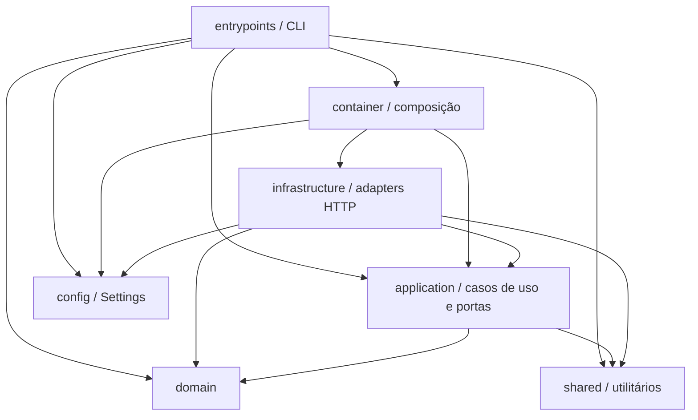
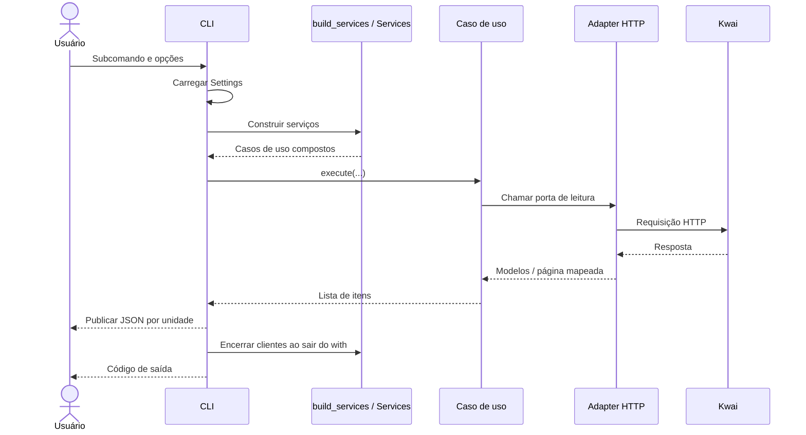
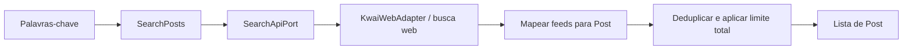
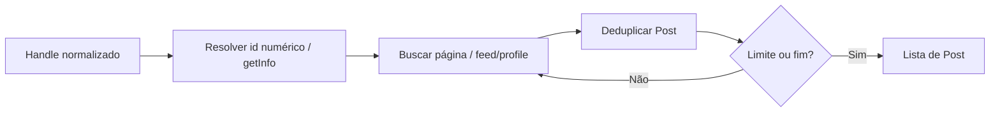
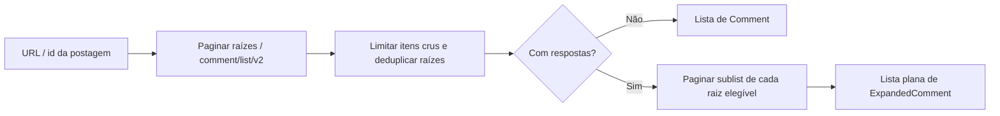

[🏠 Índice](../README.md)

# Arquitetura

## Visão geral

O Kwai Collector é uma aplicação Python síncrona de linha de comando para
coletar postagens por palavra-chave, postagens de um perfil e comentários de
uma postagem. A CLI exporta listas JSON em pastas organizadas por execução.

A organização é em camadas, com portas de leitura definidas como `Protocol`
e adapters HTTP concretos. O domínio concentra identificadores e regras de
identidade; a aplicação orquestra a coleta; a infraestrutura conhece o formato
e os endpoints do Kwai. Não há banco de dados, fila ou servidor web no fluxo
implementado. Os itens coletados permanecem em memória até a escrita da saída.

### Stack

| Componente | Uso no projeto |
|---|---|
| Python 3.11+ e Poetry | Runtime, dependências e script `kwai-collector`. |
| Typer | Subcomandos, opções e códigos de saída da CLI. |
| Pydantic | Modelos do contrato de saída. |
| pydantic-settings | Configuração via ambiente e `.env`. |
| HTTPX | Clientes HTTP síncronos para busca web e API móvel. |
| Tenacity | Retry de falhas selecionadas, com backoff exponencial. |
| Pytest e respx | Testes e simulação do transporte HTTP. |
| Ruff e mypy | Lint e análise estática de tipos. |

As dependências e os comandos de qualidade estão em
[`pyproject.toml`](../../pyproject.toml) e no [README](../../README.md).

## Organização do código

```text
src/
├── __main__.py              # Entrada por módulo e script instalado
├── config.py                # Settings
├── container.py             # Composição e encerramento dos recursos
├── entrypoints/
│   ├── cli.py               # Entrada da CLI
│   ├── export_commands.py   # Comandos ingleses e lifecycle
│   └── export_files.py      # Layout e publicação de JSON
├── application/
│   ├── ports.py             # Protocols e objetos de página
│   ├── models.py            # Post, Comment e ExpandedComment
│   ├── pagination.py        # Iteração compartilhada por pcursor
│   ├── exceptions.py        # Interrupção com parcial e cursor repetido
│   ├── search_posts.py
│   ├── collect_user_posts.py
│   ├── collect_comments.py  # Versão única e duas versões de comentários
│   ├── collect_profile_bundle.py # Coleta combinada por postagem
│   └── collection_result.py # Unidade com etapa e erro explícitos
├── domain/
│   ├── identity.py          # Normalização, extração de id e deduplicação
│   ├── business_result.py   # Validação do campo result
│   ├── constants.py
│   ├── exceptions.py
│   └── value_objects/       # Identificadores, cursor e timestamp
├── infrastructure/
│   ├── web_client.py        # Busca por palavra-chave
│   ├── mobile_client.py     # Perfil, comentários e respostas
│   ├── mapping.py           # Dados crus -> modelos de saída
│   ├── app_identity.py      # Identidade da versão do app
│   ├── signature.py         # Assinatura sig
│   ├── http_utils.py        # Decodificação JSON e retry
│   └── exceptions.py
└── shared/
    ├── logging_config.py
    └── utils/               # Coerção, timestamps e rate limit
```

### Responsabilidades e dependências

| Unidade | Responsabilidade | Dependências relevantes |
|---|---|---|
| `domain/` | Validar identificadores, reconhecer fim de cursor, formar chaves de deduplicação e interpretar erros de negócio. | Biblioteca padrão. |
| `application/` | Controlar limites, paginação e deduplicação; devolver modelos de saída ou uma interrupção com parcial. | Domínio, utilitários compartilhados, Pydantic e portas locais. |
| `infrastructure/` | Fazer HTTP, assinar requisições móveis e converter respostas. | Portas/modelos da aplicação, domínio, configuração e utilitários. |
| `entrypoints/cli.py` | Interpretar argumentos, chamar serviços, escrever JSON e converter falhas em códigos de saída. | Aplicação, domínio, configuração e composição. |
| `container.py` | Instanciar adapters, injetar portas nos casos de uso e fechar os clientes. | Configuração, aplicação e infraestrutura concreta. |
| `shared/` | Oferecer logging, coerção, conversão temporal e limitação de intervalo. | Biblioteca padrão. |

As setas abaixo representam dependências de código, não a ordem de execução:



Os casos de uso não importam os adapters concretos. As portas de I/O e os
modelos de saída pertencem à aplicação, não ao domínio. A CLI conhece a
composição, mas não importa diretamente os clientes HTTP.

## Composição e ciclo de vida

[`build_services`](../../src/container.py) cria um `KwaiWebAdapter` e um
`MobileApiAdapter`. O primeiro é injetado em `SearchPosts`; o segundo é
compartilhado por `CollectUserPosts` e `CollectComments`.

`Services` expõe os casos de uso originais, `comment_versions` e `profile_bundle`,
e funciona como context manager. Cada unidade é persistida
durante o bloco `with`, antes do fechamento.
O encerramento usa `ExitStack` para tentar fechar ambos os recursos, mesmo
quando um `close()` falha.



## Fluxos de coleta

### Busca por palavra-chave

[`SearchPosts`](../../src/application/search_posts.py) usa `SearchApiPort`,
implementada pelo [`KwaiWebAdapter`](../../src/infrastructure/web_client.py).
Cada palavra-chave processada gera uma chamada lógica ao endpoint
`POST /rest/o/w/pwa/v2/search/word/outer`; retries podem gerar novas tentativas.

Não há paginação por cursor nesse caso de uso. O `count` enviado fica entre
1 e 50. O limite final é aplicado após a deduplicação entre palavras-chave,
por id ou, na ausência dele, URL. Ao atingir o limite, as palavras-chave
restantes não são consultadas.



### Postagens de um perfil

[`CollectUserPosts`](../../src/application/collect_user_posts.py) normaliza o
handle e usa `ProfileApiPort`. O adapter móvel resolve o id numérico com
`POST /rest/o/user/getInfo`, usando o contexto completo do app. Depois busca
páginas com `POST /rest/o/feed/profile`, usando o contexto mínimo definido em
`PROFILE_MINIMAL_QUERY` e `count=30`.

Esse contexto mínimo foi validado no coletor, mas não é uma exigência universal:
o app também entregou feeds com contexto completo. A combinação responsável
pelas respostas vazias de testes anteriores não foi isolada.

A aplicação percorre `pcursor`, deduplica por id ou URL e aplica o limite a
postagens únicas. Sem limite, continua até o fim reconhecido pela paginação.



### Comentários e respostas

[`CollectComments`](../../src/application/collect_comments.py) extrai o id da
postagem e usa `CommentApiPort`. O adapter busca raízes com
`POST /rest/o/comment/list/v2`, pedindo 50 itens por página.

Aqui o limite conta **raízes recebidas antes da deduplicação**, não a quantidade
final de comentários únicos. Com `--with-comments-replies`, a aplicação primeiro coleta
as raízes e depois percorre as respostas de cada raiz elegível pelo endpoint
`POST /rest/o/comment/sublist`, pedindo 100 itens por página.

Raízes sem id ou sem quantidade declarada de respostas não geram consulta à
sublista. As respostas não consomem o limite das raízes. A saída expandida é
plana: cada raiz é seguida das respostas coletadas, com `parent_id` apontando
para a raiz. `respostas_total` representa a quantidade declarada pelo Kwai,
não uma garantia de que todas foram obtidas.

Quando a quantidade declarada difere das respostas únicas entregues, a aplicação
registra um aviso com ambas as contagens e causa não determinada. Isso também
vale para uma expansão interrompida ou uma raiz sem id consultável. O aviso não
altera o JSON, o retry nem o código de saída; as falhas continuam sob a política
de resultado parcial abaixo. Totais desconhecidos não são comparados.



### Paginação compartilhada

[`iter_pages`](../../src/application/pagination.py) começa com cursor vazio e
busca a próxima página somente quando o consumidor a solicita. Uma página
vazia ou um cursor de fim encerra a iteração. Os valores de fim são
`""`, `no_more`, `nomore`, `-1` e `0`, definidos em
[`Cursor`](../../src/domain/value_objects/cursor.py).

Um cursor de continuação já visto causa `RepeatedCursorError`. A página é
entregue ao consumidor antes dessa verificação; itens dela podem integrar o
resultado parcial. Parar de consumir ao atingir um limite não busca uma página
extra. Não há checkpoint persistente de cursor nem retomada entre execuções.

## Integração HTTP e resiliência

| Aspecto | Comportamento implementado |
|---|---|
| Busca web | Retry para falhas de transporte e HTTP `429`, `500`, `502`, `503`, `504`. Outros erros HTTP não são repetidos. |
| API móvel | Tenta `api.kwai-pro.com`, `api1-us.kwai-pro.com` e `api2-us.kwaipros.com`, nessa ordem. Falha HTTP ou corpo que não seja objeto JSON leva ao próximo gateway. |
| Retry móvel | Se todos os gateways falharem, repete a escada inteira até esgotar as tentativas extras configuradas. |
| Backoff | Exponencial, de 0,5 a 8 segundos; `max_retries` conta tentativas extras depois da primeira. |
| Erro de negócio | `result` diferente de `1`, quando não nulo, gera `KwaiApiError`. Ausência de `result` é tolerada. Erro de negócio não aciona retry nem troca de gateway. |
| Rate limit | Cada adapter tem seu próprio `RateLimiter`. Na busca, espera a cada tentativa; na API móvel, espera no início de cada rodada da escada, não entre hosts dessa rodada. |
| Mapeamento de feeds | Feeds sem dados suficientes para montar a URL são ignorados com aviso; os demais itens continuam. |

A API móvel usa requisições assinadas, sem fluxo de login implementado.
[`compute_sig`](../../src/infrastructure/signature.py) combina parâmetros de query
e corpo, ordena as chaves, concatena `k=v` sem separadores e calcula MD5 com o
sal da identidade do app. `sig`, `__NS_sig3` e `__NStokensig` ficam fora desse
cálculo. Versão, chave do cliente e sal estão concentrados em
[`app_identity.py`](../../src/infrastructure/app_identity.py).

As rotas usadas pelo coletor foram validadas sem `__NS_sig3`. Seu algoritmo não
foi reproduzido: chamadas observadas de `atlasSign` receberam entradas muito
maiores que apenas caminho + `sig`, portanto essa hipótese não é uma fórmula
comprovada. Não há instrumentação do app no fluxo de coleta.

O adapter implementa fallback **entre gateways**. Não implementa uma segunda
tentativa automática trocando o contexto completo pelo mínimo: o contexto é
selecionado na montagem da requisição de cada rota.

### Interrupções e resultado parcial

Se um `KwaiCollectorError` interrompe a coleta depois de obter itens, a aplicação
lança [`CollectionInterruptedError`](../../src/application/exceptions.py), com os
itens em `partial` e a causa original em `__cause__`. Sem itens, propaga a causa.
A CLI tenta escrever o parcial e termina com código `1`; se essa escrita
também falhar com `OSError`, registra a falha e mantém o código `1`.

Um cursor repetido na sublista de respostas é tratado localmente: registra
aviso, preserva as respostas já lidas e continua com as próximas raízes.
Outras falhas de coleta durante a expansão interrompem a operação, preservando
as respostas lidas e também as raízes cuja expansão ainda não foi iniciada.
Não há garantia de persistência se a escrita da saída falhar.

## Contratos de dados e saída

[`models.py`](../../src/application/models.py) define `Post`, `Comment`, seus
objetos de autor/engajamento e a extensão opt-in `ExpandedComment`.
Os modelos rejeitam campos extras. Valores opcionais desconhecidos ficam
como `None`, serializados como `null`; o mapeamento não preenche métricas
ausentes com zero. Os helpers de timestamp produzem ISO-8601 UTC com sufixo `Z`.
Cada execução de caso de uso gera um único `coletado_em` para seus itens.

[`mapping.py`](../../src/infrastructure/mapping.py) conhece os nomes de campos
externos, limpa textos, constrói URLs e converte dados para esses modelos.
Os casos de uso recebem modelos/páginas, não respostas HTTP cruas.

A [exportação da CLI](../../src/entrypoints/export_files.py) serializa com `model_dump()` e
`json.dumps(..., ensure_ascii=False, indent=2)`. A saída é UTF-8.
`--out` é pasta-base opcional (padrão `exports`), cada execução é exclusiva
e cada JSON é publicado por rename de temporário. Parciais usam `.partial.json`.
As unidades são persistidas entre etapas de coleta, não a cada página HTTP.
Veja [CLI](../guides/cli.md).

`CollectionResult` identifica explicitamente `kind`, `stage` e `error`.
`CollectCommentVersions` entrega raízes e expansão separadamente; se raízes
falharem, não entrega uma expansão falsa. `CollectProfileBundle` entrega posts
e isola comentários por postagem. A escrita permanece no entrypoint, sem nova
porta de storage ou dependência de filesystem na aplicação.

| Código de saída | Situação |
|---|---|
| `0` | Comando concluído sem erro. |
| `1` | Falha de coleta, configuração inválida ou falha de escrita tratada pela CLI. |
| `2` | Entrada inválida reconhecida pelo domínio ou erro de argumentos da CLI. |

## Configuração e observabilidade

[`Settings`](../../src/config.py) lê `.env` e variáveis com prefixo `KWAI_`:
`REQUEST_DELAY`, `HTTP_TIMEOUT`, `MAX_RETRIES` e `USER_AGENT`.
O User-Agent configurável é usado somente pelo adapter web; o móvel usa o da
identidade do app. Padrões e exemplos estão no [README](../../README.md).

O logging usa o namespace `src`, com nível `INFO` por padrão e `DEBUG` com
`--verbose`. Registra coleta, retries, fallbacks, itens ignorados e falhas.
Não há serviço externo de telemetria no fluxo implementado.

## Verificação e limites

| Área | Testes existentes |
|---|---|
| Orquestração sem HTTP, deduplicação e resultados parciais | `tests/test_usecases.py` |
| Paginação compartilhada | `tests/test_pagination.py` |
| Integração dos casos de uso com HTTP simulado | `tests/test_collector.py` |
| API móvel, assinatura, contextos de rota e gateways | `tests/test_mobile_api.py` |
| Capturas sanitizadas: mapeamento e paginação offline | `tests/test_mobile_captures.py` |
| CLI e gravação de saída | `tests/test_cli.py` |
| Contratos e mapeamento | `tests/test_models.py`, `tests/test_parsers.py`, `tests/test_samples.py` |
| Identificadores e rate limit | `tests/test_domain.py`, `tests/test_ratelimit.py` |

A coleta depende de endpoints e formatos externos do Kwai. Fim de paginação
significa fim informado pela resposta, não prova de completude de todo o
conteúdo da plataforma. Mudanças nas rotas, no contexto aceito ou na identidade
da assinatura podem exigir manutenção dos adapters.

Esta documentação descreve a implementação examinada. Não implica validação
ao vivo dos endpoints nem cobertura de todos os cenários de falha pelas suítes
listadas. Veja [Referência Python](../reference/api-reference.md), [Fluxos](../flows/README.md),
[Assinatura](./signature.md), [Schemas](../reference/schemas.md) e
[Manutenção](../maintenance/maintenance.md) para a referência operacional detalhada.

As políticas estão em [Regras de negócio](../business-rules/README.md); a interface
observável em [Casos de uso](../use-cases/README.md). As
[ADRs](../adr/README.md) registram escolhas já adotadas e seus custos, sem propor
novos boundaries ou atribuir uma data histórica não comprovada.
