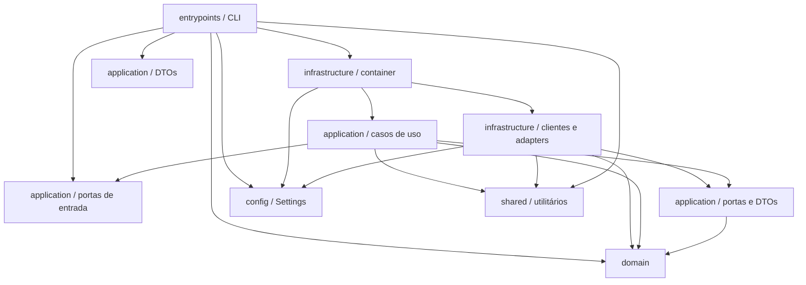
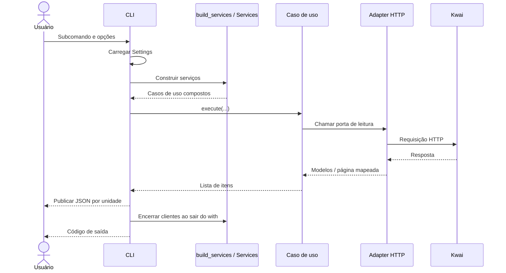
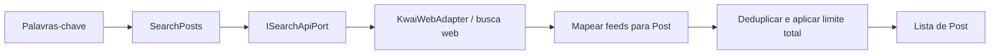
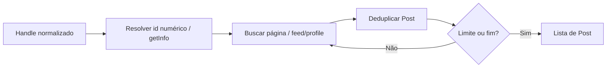
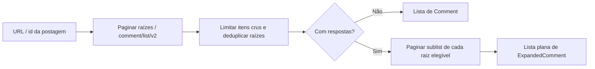

[🏠 Índice](../README.md)

# Arquitetura

## Visão geral

O Kwai Collector é uma aplicação Python síncrona de linha de comando para
coletar postagens por palavra-chave, postagens de um perfil e comentários de
uma postagem. A CLI exporta listas JSON em pastas organizadas por execução.

A organização segue DDD tático com Ports & Adapters: as portas de entrada e
saída são classes abstratas (`ABC`, prefixo `I` e sufixo `Port`) definidas na
aplicação. Casos de uso implementam as portas de entrada; adapters HTTP
implementam as portas de saída. O domínio concentra
as entidades `Post` e `Comment`, identificadores e as regras de identidade,
paginação e ordenação; a aplicação valida a entrada em comandos e orquestra a
coleta; a infraestrutura conhece o formato, os endpoints e os tamanhos de
página do Kwai. Não há banco de dados, fila ou servidor web no fluxo
implementado, portanto não há repositórios de domínio. Os itens coletados permanecem em memória até a escrita da saída.

### Stack

| Componente | Uso no projeto |
|---|---|
| Python 3.11+ e Poetry | Runtime, dependências e script `kwai-collector`. |
| Typer | Subcomandos, opções e códigos de saída da CLI. |
| pydantic-settings | Configuração via ambiente e `.env` (único uso de Pydantic). |
| HTTPX | Clientes HTTP síncronos para busca web e API móvel. |
| Tenacity | Retry de falhas selecionadas, com backoff exponencial. |
| Pytest e respx | Testes e simulação do transporte HTTP. |
| Ruff e mypy | Lint e análise estática de tipos. |

As dependências e os comandos de qualidade estão em
[`pyproject.toml`](../../pyproject.toml) e no [README](../../README.md).

## Organização do código

```text
src/
├── __main__.py                        # Entrada por módulo e script instalado
├── config/
│   └── settings.py                    # Settings (parâmetros técnicos, sem credenciais)
├── domain/
│   ├── entities/                      # Post, Comment e ExpandedComment
│   ├── value_objects/                 # Handle, ids, PostReference, Cursor e IsoTimestamp
│   ├── enums/post_sort_by.py          # Contagem usada na ordenação
│   ├── exceptions/domain_exceptions.py # Base, entrada/valor inválidos e cursor repetido
│   └── services/
│       ├── identity.py                # UniqueItems: primeira ocorrência por dedup_key
│       ├── post_urls.py               # Formato das URLs do Kwai: montar e extrair id/dono
│       ├── replies.py                 # Elegibilidade para expansão e divergência de contagem
│       ├── pagination.py              # Decisão pura de continuação, fim e laço de cursor
│       └── post_ordering.py           # Ordenação por contagem
├── application/
│   ├── ports/                         # Portas de entrada dos casos de uso e de saída (API/relógio)
│   ├── dtos/
│   │   ├── commands.py                # Comandos de entrada validados
│   │   ├── pages.py                   # Páginas devolvidas pelas portas
│   │   └── collection_result.py       # Unidade com etapa e erro explícitos
│   ├── use_cases/
│   │   ├── search_posts.py
│   │   ├── collect_user_posts.py
│   │   ├── collect_comment_versions.py # Raízes e expansão de respostas
│   │   └── collect_profile_bundle.py  # Coleta combinada por postagem
│   ├── pagination.py                  # iter_pages: coordenação da busca sob demanda
│   └── exceptions.py                  # Falha de serviço externo e interrupção com parcial
├── infrastructure/
│   ├── container/container.py         # Composição e encerramento dos recursos
│   ├── clock/system_clock.py          # SystemClock (IClockPort)
│   └── kwai/
│       ├── mapping.py                 # Dados crus -> entidades
│       ├── coercion.py                # Escalares crus e timestamps em ms
│       ├── business_result.py         # Validação do campo result
│       ├── http_utils.py              # Decodificação JSON, leitura de listas/cursor e retry
│       ├── ratelimit.py               # Intervalo mínimo entre requisições
│       ├── exceptions.py              # Transporte, resposta inesperada e erro de negócio
│       ├── web/
│       │   ├── client.py              # KwaiWebClient: sessão, rate limit e retry
│       │   └── adapter.py             # KwaiWebAdapter: busca por palavra-chave
│       └── mobile/
│           ├── client.py              # MobileApiClient: sessão, assinatura e escada de gateways
│           ├── adapter.py             # MobileApiAdapter: perfil, comentários e respostas
│           ├── signature.py           # Assinatura sig
│           └── app_identity.py        # Identidade da versão do app
├── entrypoints/
│   └── cli/
│       ├── app.py                     # Entrada da CLI
│       ├── export_commands.py         # Comandos ingleses e lifecycle
│       └── export_files.py            # Layout e publicação de JSON
└── shared/
    └── logging/logging_config.py
```

Cada integração separa o **cliente** (sessão, credenciais de assinatura, rate
limit e retry) do **adapter** (rota, contexto, corpo, tamanho de página e
mapeamento para entidades), que implementa a porta usando o cliente.

### Responsabilidades e dependências

| Unidade | Responsabilidade | Dependências relevantes |
|---|---|---|
| `domain/` | Definir as entidades do contrato, validar identificadores, formar chaves e manter a primeira ocorrência na deduplicação, montar e interpretar URLs do Kwai, decidir expansão e divergência de respostas, continuação/fim/laço da paginação e ordenar postagens. | Biblioteca padrão. |
| `application/` | Declarar as portas de entrada e saída; validar a entrada em comandos; orquestrar paginação, limites e as regras do domínio; devolver `CollectionResult` com o parcial e a falha. | Domínio e `shared/` (logging). |
| `infrastructure/` | Implementar as portas: fazer HTTP, assinar requisições móveis, escolher tamanhos de página, interpretar o campo `result`, converter respostas e fornecer o relógio. | Aplicação (portas e DTOs), domínio, configuração e `shared/`. |
| `infrastructure/container/` | Único lugar que instancia clientes, adapters e relógio; injeta as portas nos casos de uso e fecha os clientes. | Configuração, casos de uso e infraestrutura concreta. |
| `entrypoints/` | Montar comandos a partir dos argumentos, chamar os casos de uso pelo container, escrever JSON e converter falhas em códigos de saída. | DTOs da aplicação; entidades, enum, exceções e `PostReference` do domínio; configuração e container. Nunca serviços de domínio nem infraestrutura concreta. |
| `shared/` | Oferecer a configuração de logging. | Biblioteca padrão. |

As setas abaixo representam dependências de código, não a ordem de execução:



O domínio não importa nada de fora dele. Os casos de uso dependem das portas
(classes abstratas) e nunca dos adapters, nem de Pydantic. A CLI só alcança a
infraestrutura pelo container e não chama serviços de domínio: a validação da
entrada fica nos comandos. A CLI usa as portas de entrada expostas por
`Services`; `CollectProfileBundle` também recebe suas coletas por essas
interfaces, sem importar as implementações. Trocar um adapter não exige
mudança na aplicação.

## Composição e ciclo de vida

[`build_services`](../../src/infrastructure/container/container.py) cria um
`KwaiWebClient` e um `MobileApiClient` (donos das sessões HTTP), os adapters
`KwaiWebAdapter` e `MobileApiAdapter` sobre eles e um `SystemClock`. O adapter web
é injetado em `SearchPosts`; o móvel implementa as duas portas e é injetado em
`CollectUserPosts` e `CollectCommentVersions`, que recebem o relógio.
`CollectProfileBundle` recebe essas duas coletas pelas portas
`ICollectUserPostsPort` e `ICollectCommentVersionsPort`; a mesma instância de
`CollectCommentVersions` serve `comment_versions` e o bundle.

`Services` expõe `search_posts`, `comment_versions` e `profile_bundle` pelos
contratos `ISearchPostsPort`, `ICollectCommentVersionsPort` e
`ICollectProfileBundlePort`, e funciona como context manager. Cada unidade é persistida
durante o bloco `with`, antes do fechamento.
O encerramento usa `ExitStack` para tentar fechar ambos os clientes, mesmo
quando um `close()` falha.



## Fluxos de coleta

### Busca por palavra-chave

[`SearchPosts`](../../src/application/use_cases/search_posts.py) usa `ISearchApiPort`,
implementada pelo [`KwaiWebAdapter`](../../src/infrastructure/kwai/web/adapter.py).
Cada página gera uma chamada lógica ao endpoint
`POST /rest/o/w/pwa/v2/search/word/outer`; retries podem gerar novas tentativas.

A busca pagina por deslocamento. O caso de uso pede o `limit` a cada página; o
adapter envia `count` entre 1 e `SEARCH_PAGE_SIZE` (50) e o `pcursor` da página,
e devolve o deslocamento da próxima. Cada palavra termina na primeira página
sem post novo, porque a API repete itens em vez de devolver lista vazia. O limite final é aplicado após a deduplicação entre palavras-chave,
por id ou, na ausência dele, URL. Ao atingir o limite, as palavras-chave
restantes não são consultadas.



### Postagens de um perfil

[`CollectUserPosts`](../../src/application/use_cases/collect_user_posts.py), acionado por
`CollectProfileBundle`, recebe o handle já normalizado no comando e usa
`IProfileApiPort`. O adapter móvel resolve o id numérico com
`POST /rest/o/user/getInfo`, usando o contexto completo do app. Depois busca
páginas com `POST /rest/o/feed/profile`, usando o contexto mínimo definido em
`PROFILE_MINIMAL_QUERY` e `count=30` (`PROFILE_PAGE_SIZE`).

Esse contexto mínimo foi validado no coletor, mas não é uma exigência universal:
o app também entregou feeds com contexto completo. A combinação responsável
pelas respostas vazias de testes anteriores não foi isolada.

A aplicação percorre `pcursor`, deduplica por id ou URL e aplica o limite a
postagens únicas. Sem limite, continua até o fim reconhecido pela paginação.



### Comentários e respostas

[`CollectCommentVersions`](../../src/application/use_cases/collect_comment_versions.py) recebe a
postagem já validada no comando (`PostReference`) e usa `ICommentApiPort`. O
adapter busca raízes com `POST /rest/o/comment/list/v2`, pedindo 50 itens por
página (`COMMENTS_PAGE_SIZE`).

Aqui o limite conta **raízes recebidas antes da deduplicação**, não a quantidade
final de comentários únicos. Com `--with-comments-replies`, a aplicação primeiro coleta
as raízes e depois percorre as respostas de cada raiz elegível pelo endpoint
`POST /rest/o/comment/sublist`, pedindo 100 itens por página (`SUBLIST_PAGE_SIZE`).

Raízes sem id ou sem quantidade declarada de respostas não geram consulta à
sublista. As respostas não consomem o limite das raízes. A saída expandida é
plana: cada raiz é seguida das respostas coletadas, com `parent_id` apontando
para a raiz. `respostas_total` representa a quantidade declarada pelo Kwai,
não uma garantia de que todas foram obtidas.

Quando a quantidade declarada difere das respostas únicas entregues, a aplicação
registra um aviso com ambas as contagens e causa não determinada. Isso também
vale para uma expansão interrompida ou uma raiz sem id consultável. O aviso não
altera o JSON, o retry nem o código de saída; as falhas continuam sob a política
de resultado parcial abaixo. Totais desconhecidos não são comparados.



### Paginação compartilhada

[`iter_pages`](../../src/application/pagination.py) começa com cursor vazio e
busca a próxima página somente quando o consumidor a solicita. Uma página
vazia ou um cursor vazio ([`Cursor`](../../src/domain/value_objects/cursor.py))
encerra a iteração. Os sentinelas de fim do Kwai (`no_more`, `nomore`, `-1` e
`0`) são protocolo e ficam na infraestrutura:
[`read_cursor`](../../src/infrastructure/kwai/http_utils.py) os traduz para
cursor vazio, então o domínio não conhece o formato de nenhuma origem.
A aplicação mantém os cursores vistos e executa as consultas; a função pura
[`get_continuation_cursor`](../../src/domain/services/pagination.py) recebe a
continuação, a indicação de página vazia e os cursores vistos para decidir se
a coleta continua. O domínio não executa o callback de busca.

Um cursor de continuação já visto causa `RepeatedCursorError`. A página é
entregue ao consumidor antes dessa verificação; itens dela podem integrar o
resultado parcial. Parar de consumir ao atingir um limite não busca uma página
extra. Não há checkpoint persistente de cursor nem retomada entre execuções.

## Integração HTTP e resiliência

| Aspecto | Comportamento implementado |
|---|---|
| Busca web | Retry para falhas de transporte e HTTP `429`, `500`, `502`, `503`, `504`. Outros erros HTTP não são repetidos. |
| API móvel | Tenta `api.kwai-pro.com`, `api1-us.kwai-pro.com` e `api2-us.kwaipros.com`, nessa ordem. Falha HTTP ou corpo que não seja objeto JSON leva ao próximo gateway. |
| Retry móvel | Se todos os gateways falharem e ao menos uma falha for transitória (transporte, `429`/`5xx`, corpo não-JSON), repete a escada inteira até esgotar as tentativas extras configuradas. Só status permanentes (ex.: `403`) encerram sem nova rodada. |
| Backoff | Exponencial, de 0,5 a 8 segundos; `max_retries` conta tentativas extras depois da primeira. |
| Erro de negócio | `result` diferente de `1`, quando não nulo, gera `KwaiApiError`. Ausência de `result` é tolerada. Erro de negócio não aciona retry nem troca de gateway. |
| Rate limit | Cada cliente tem seu próprio `RateLimiter`. Na busca, espera a cada tentativa; na API móvel, espera antes de cada requisição, inclusive entre hosts da mesma rodada. |
| Mapeamento de feeds | Feeds sem dados suficientes para montar a URL são ignorados com aviso; os demais itens continuam. |

A API móvel usa requisições assinadas, sem fluxo de login implementado.
[`compute_sig`](../../src/infrastructure/kwai/mobile/signature.py) combina parâmetros de query
e corpo, ordena as chaves, concatena `k=v` sem separadores e calcula MD5 com o
sal da identidade do app. `sig`, `__NS_sig3` e `__NStokensig` ficam fora desse
cálculo. Versão, chave do cliente e sal estão concentrados em
[`app_identity.py`](../../src/infrastructure/kwai/mobile/app_identity.py).

As rotas usadas pelo coletor foram validadas sem `__NS_sig3`. Seu algoritmo não
foi reproduzido: chamadas observadas de `atlasSign` receberam entradas muito
maiores que apenas caminho + `sig`, portanto essa hipótese não é uma fórmula
comprovada. Não há instrumentação do app no fluxo de coleta.

O adapter implementa fallback **entre gateways**. Não implementa uma segunda
tentativa automática trocando o contexto completo pelo mínimo: o contexto é
selecionado na montagem da requisição de cada rota.

### Interrupções e resultado parcial

Se um `KwaiCollectorError` interrompe a coleta depois de obter itens, a aplicação
lança internamente [`CollectionInterruptedError`](../../src/application/exceptions.py),
com os itens em `partial` e a causa original em `__cause__`. Sem itens, propaga
a causa. Os casos de uso expostos convertem essa falha em `CollectionResult`
com `error` e o parcial em `items`. A CLI tenta escrever o parcial e termina com código `1`; se essa escrita
também falhar com `OSError`, registra a falha e mantém o código `1`.

Um cursor repetido na sublista de respostas é tratado localmente: registra
aviso, preserva as respostas já lidas e continua com as próximas raízes.
Outras falhas de coleta durante a expansão interrompem a operação, preservando
as respostas lidas e também as raízes cuja expansão ainda não foi iniciada.
Não há garantia de persistência se a escrita da saída falhar.

## Contratos de dados e saída

[`domain/entities`](../../src/domain/entities) define `Post`, `Comment`, seus
objetos de autor/engajamento e a extensão opt-in `ExpandedComment`, como
dataclasses imutáveis. O construtor exige os campos obrigatórios e rejeita
extras. Valores opcionais desconhecidos ficam como `None`, serializados como
`null`; o mapeamento não preenche métricas ausentes com zero. O formato
ISO-8601 UTC com sufixo `Z` é definido por `IsoTimestamp.from_datetime`, usado
pelo relógio e pela conversão de timestamps do Kwai. Cada execução de caso de uso
lê o `IClockPort` injetado uma única vez e gera um único `coletado_em` para seus itens.

[`mapping.py`](../../src/infrastructure/kwai/mapping.py) conhece os nomes de campos
externos, limpa textos e converte dados para as entidades. As URLs de postagem e
de perfil vêm de [`post_urls.py`](../../src/domain/services/post_urls.py), única
fonte do formato de URL do Kwai: o mapeamento monta, os comandos extraem id e
dono, e a CLI só lê `PostReference.owner` para nomear o diretório.
Os casos de uso recebem entidades/páginas, não respostas HTTP cruas.

A [exportação da CLI](../../src/entrypoints/cli/export_files.py) serializa com `dataclasses.asdict()` e
`json.dumps(..., ensure_ascii=False, indent=2)`. A saída é UTF-8.
`--out` é pasta-base opcional (padrão `exports`), cada execução é exclusiva
e cada JSON é publicado por rename de temporário. Parciais usam `.partial.json`.
As unidades são persistidas entre etapas de coleta, não a cada página HTTP.
Veja [CLI](../guides/cli.md).

`CollectionResult[T]` identifica `kind`, `error` e a `stage` derivada de `kind`.
`CollectCommentVersions` entrega raízes e expansão separadamente; se raízes
falharem, não entrega uma expansão falsa. `CollectProfileBundle` entrega posts
e isola comentários por postagem. A escrita permanece no entrypoint, sem nova
porta de storage ou dependência de filesystem na aplicação.

| Código de saída | Situação |
|---|---|
| `0` | Comando concluído sem erro. |
| `1` | Falha de coleta, configuração inválida ou falha de escrita tratada pela CLI. |
| `2` | Entrada inválida reconhecida pelo domínio ou erro de argumentos da CLI. |

## Configuração e observabilidade

[`Settings`](../../src/config/settings.py) lê `.env` e variáveis com prefixo `KWAI_`:
`REQUEST_DELAY`, `HTTP_TIMEOUT`, `MAX_RETRIES` e `USER_AGENT`.
O User-Agent configurável é usado somente pelo adapter web; o móvel usa o da
identidade do app. Padrões e exemplos estão no [README](../../README.md).

O logging usa o namespace `src`, com nível `INFO` por padrão e `DEBUG` com
`--verbose`. Registra coleta, retries, fallbacks, itens ignorados e falhas.
Não há serviço externo de telemetria no fluxo implementado.

## Verificação e limites

| Área | Testes existentes |
|---|---|
| Orquestração sem HTTP, deduplicação e resultados parciais | `tests/unit/test_usecases.py` |
| Paginação compartilhada | `tests/unit/test_pagination.py` |
| Integração dos casos de uso com HTTP simulado | `tests/integration/test_collector.py` |
| API móvel, assinatura, contextos de rota e gateways | `tests/integration/test_mobile_api.py` |
| Capturas sanitizadas: mapeamento e paginação offline | `tests/integration/test_mobile_captures.py` |
| CLI e gravação de saída | `tests/integration/test_cli.py` |
| Contratos e mapeamento | `tests/unit/test_models.py`, `tests/unit/test_parsers.py`, `tests/unit/test_samples.py` |
| Identificadores e rate limit | `tests/unit/test_domain.py`, `tests/unit/test_ratelimit.py` |
| Protocolo do Kwai: `pcursor` e campo `result` | `tests/unit/test_kwai_protocol.py` |

A coleta depende de endpoints e formatos externos do Kwai. Fim de paginação
significa fim informado pela resposta, não prova de completude de todo o
conteúdo da plataforma. Mudanças nas rotas, no contexto aceito ou na identidade
da assinatura podem exigir manutenção dos adapters.

Esta documentação descreve a implementação examinada. Não implica validação
ao vivo dos endpoints nem cobertura de todos os cenários de falha pelas suítes
listadas. Veja [Referência Python](../reference/api-reference.md), [Fluxos](../flows/README.md),
[Assinatura](./signature.md), [Schemas](../reference/schemas.md) e
[Manutenção](../maintenance/maintenance.md) para a referência operacional detalhada.

As políticas estão em [Regras de negócio](../business-rules/README.md); a interface
observável em [Casos de uso](../use-cases/README.md). As
[ADRs](../adr/README.md) registram escolhas já adotadas e seus custos, sem propor
novos boundaries ou atribuir uma data histórica não comprovada.
