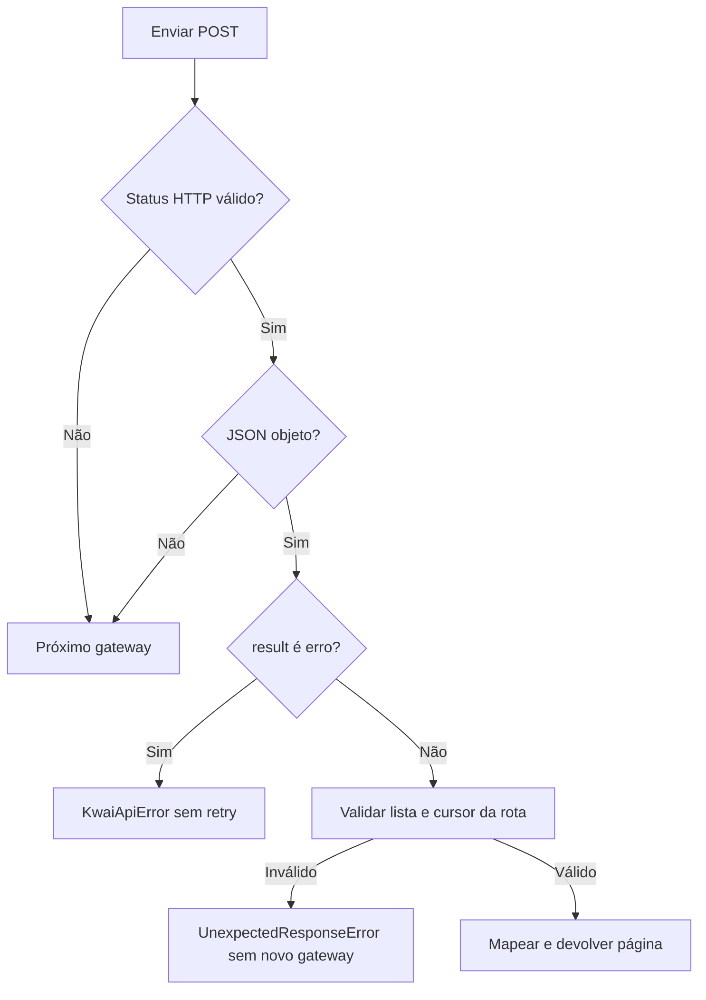

[🏠 Índice](../README.md)

# Protocolo móvel e integração HTTP

## Escopo e hosts

O [`MobileApiAdapter`](../../src/infrastructure/mobile_client.py) implementa as
portas de perfil e comentários. Os nomes abaixo são os usados no código atual,
não nomes de uma API oficial estável.

| Ordem | Constante | Host |
|---|---|---|
| 1 | `COMMENT_HOST` | `https://api.kwai-pro.com` |
| 2 | Primeiro `COMMENT_FALLBACK_HOSTS` | `https://api1-us.kwai-pro.com` |
| 3 | Segundo `COMMENT_FALLBACK_HOSTS` | `https://api2-us.kwaipros.com` |

`COMMENT_HOSTS` reúne os três. Apesar do prefixo `COMMENT_`, a mesma escada serve
para `getInfo` e `feed/profile`. Fallback troca o host, não a rota, o alvo ou o
contexto. A mesma assinatura é reutilizada porque a fórmula implementada não
inclui o host.

## Rotas e campos

Todas as rotas móveis abaixo usam `POST`, query na URL e corpo de formulário.
`sig` fica no corpo. A busca web é separada e usa JSON, sem esse assinador.

| Operação | Caminho | Contexto de query | Dados de resposta usados |
|---|---|---|---|
| Resolver handle | `/rest/o/user/getInfo` | Completo + timestamp/sessão | `users[0].user_id`. |
| Postagens do perfil | `/rest/o/feed/profile` | `kpn`, `appver` | `feeds`, `pcursor`. |
| Comentários raiz | `/rest/o/comment/list/v2` | Completo + timestamp/sessão | `rootComments`, `sub_comment_count`, `pcursor`. |
| Respostas de uma raiz | `/rest/o/comment/sublist` | Completo + timestamp/sessão | `subComments`, `pcursor`. |

### Query completa

`DEFAULT_QUERY` contém os seguintes grupos. Esta lista documenta o que o cliente
envia; não prova que cada campo seja obrigatório no servidor:

| Grupo | Chaves |
|---|---|
| App e distribuição | `appver`, `ver`, `pkg`, `app`, `kpn`, `kpf`, `c`, `abi`, `kwai_tiny_type`. |
| Ambiente/dispositivo | `mod`, `sys`, `ud`, `ds`, `vid`, `egid`, `did`. |
| Idioma/região | `language`, `lon`, `lat`, `mcc`, `countryInfo`, `country_code`, `time_zone`, `bucket`. |
| Rede/contexto | `oc`, `net`, `netScore`. |
| Gerados por chamada lógica | `timestamp` e `session_id`, adicionados por `_signed_query()`. |

Os valores completos estão no código; não é necessário duplicar identificadores
de dispositivo em manuais ou capturas compartilhadas. O cliente usa o contexto
de referência e não registra um dispositivo novo nem obtém fingerprint dinamicamente.

O header móvel é `User-Agent: kwai-android`, com `Accept: application/json`.
`KWAI_USER_AGENT` não o substitui. Não há envio explícito de cookie de login.
Isso não é uma garantia geral de que o HTTPX nunca possa receber cookies de um servidor.

### `getInfo`

| Campo do corpo | Montagem |
|---|---|
| `userIds` | `@` seguido de `Handle.value`. |
| `client_key` | `CLIENT_KEY` da identidade do app. |
| `os` | `android`. |
| `sig` | Digest dos mapas finais de query e corpo. |

O caso de uso normaliza `@` e espaços antes de criar `Handle`. O adapter usa o
primeiro usuário retornado; não faz busca por igualdade de handle em toda a lista.
Lista vazia ou primeiro usuário sem `user_id` gera `UnexpectedResponseError`.
O valor é convertido para string e validado por `UserId`.

### `feed/profile`

Query: `PROFILE_MINIMAL_QUERY = {"kpn": "KWAI", "appver": APP_VERSION}`.

| Campo do corpo | Montagem |
|---|---|
| `user_id` | Id numérico resolvido, não handle. |
| `count` | String do tamanho pedido; o caso de uso pede 30. |
| `privacy` | `public`. |
| `lang` | `en`. |
| `pcursor` | Vazio na primeira chamada; depois o cursor recebido. |
| `client_key`, `os`, `sig` | Chave da identidade, `android` e digest. |

O contexto mínimo foi validado no coletor. O app também entregou feeds com o
completo; a diferença entre combinações anteriores não foi isolada. Não há
fallback automático para trocar um contexto pelo outro.

### `comment/list/v2`

Corpo: cópia de `DEFAULT_BODY` mais campos dinâmicos.

| Campo | Valor |
|---|---|
| `photoId` | Id extraído da URL. |
| `count` | String do tamanho pedido; normalmente 50. |
| `pcursor` | Cursor corrente. |
| `order` | `desc`. |
| `photoPageType`, `requestType` | `0`, `3`. |
| `isPreload`, `preloadSource` | `false`, string vazia. |
| `os`, `client_key`, `sig` | `android`, identidade atual e assinatura. |

`commentCount` e previews em `subCommentsMap` não alimentam a saída nem
determinam o fim. A expansão de respostas consulta `sublist` separadamente.

### `comment/sublist`

| Campo | Valor |
|---|---|
| `photoId` | Id da postagem. |
| `rootCommentId` | Id do comentário raiz. |
| `order` | `desc`. |
| `pcursor` | Cursor da sublista, independente do cursor das raízes. |
| `count` | Limitado no adapter a 1–100; o caso de uso pede 100. |
| `client_key`, `sig` | Identidade atual e digest. |

Não copie todo `DEFAULT_BODY` para essa rota: o corpo atual de sublista não
contém `os`, `isPreload`, `photoPageType` ou `requestType`.

## Como uma resposta se torna uma página

Há duas classes diferentes de “JSON malformado”:

- **Não-JSON ou JSON que não é objeto:** falha durante a escada; tenta outro host.
- **Objeto JSON com lista/item/cursor de tipo inválido:** falha depois que o
  gateway já respondeu; não há nova tentativa de transporte por esse motivo.

`result` ausente ou nulo é tolerado. O código compara com `1`; não aplica
validação estrita de tipo ao campo. `result != 1` não nulo gera `KwaiApiError`,
com mensagem original ou padrão, código e rota. `HTTP 200` não basta para sucesso.

`rootComments`, `subComments` e `users`: ausente/nulo vira lista vazia; não-lista
ou item não-objeto rejeita a página inteira. Feeds têm uma política distinta,
documentada em [Schemas](../reference/schemas.md).

`pcursor` aceita string ou inteiro, rejeita booleano, float, lista e objeto.
Ausente, nulo ou zero vira string vazia. Não é um índice que o cliente incrementa.

## Retry, ritmo e custo

| Aspecto | API móvel | Busca web |
|---|---|---|
| Falha de rede/HTTP | Próximo gateway; esgotados os hosts, repete a rodada. | Retry de transporte e de `429`, `500`, `502`, `503`, `504`. |
| Outros status de erro | Também levam ao próximo gateway e podem esgotar/replicar a escada. | Propagados sem retry adicional. |
| Erro de negócio | Sem fallback e sem retry. | Sem retry. |
| Espera de rate limit | Antes de cada rodada; não entre hosts da mesma rodada. | Antes de cada tentativa. |
| Backoff | Exponencial: 0,5; 1; 2; 4; até teto de 8 segundos. | Mesma política. |

Com `max_retries=3`, são no máximo quatro rodadas móveis × três hosts = **12
tentativas HTTP por chamada lógica**, se todos os hosts falharem em todas as
rodadas. A busca pode fazer até quatro tentativas no mesmo host por palavra.
Isso não define um prazo máximo total nem uma taxa global compartilhada.

O contexto, a assinatura e o cursor são preservados em cada retry. A coleta é
síncrona, e a quantidade de raízes elegíveis pode multiplicar chamadas de sublista.
Consulte [Fluxos](../flows/README.md) e [Manutenção](../maintenance/maintenance.md) antes de aumentar volume.
