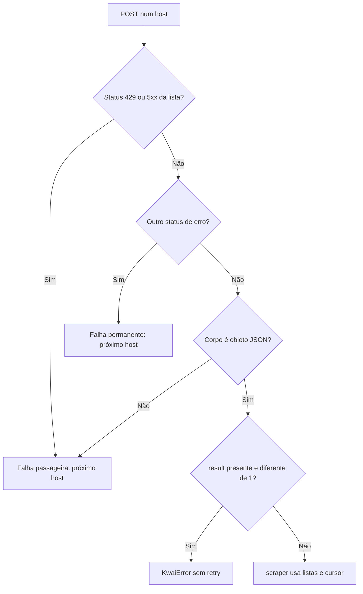

[🏠 Índice](../README.md)

# Protocolo móvel e integração HTTP

## Escopo e hosts

[`client.py`](../../kwai_collector/client.py) guarda os hosts, o rate limit, o
retry, a assinatura e a troca de host. [`scraper.py`](../../kwai_collector/scraper.py)
decide a rota, o contexto (query), o corpo e o tamanho de página. Os nomes
abaixo são os usados no código, não nomes de uma API oficial estável.

| Ordem | Host |
|---|---|
| 1 | `https://api.kwai-pro.com` |
| 2 | `https://api1-us.kwai-pro.com` |
| 3 | `https://api2-us.kwaipros.com` |

A lista `MOBILE_HOSTS` serve para todas as rotas móveis: `getInfo`,
`feed/profile`, `comment/list/v2` e `comment/sublist`. A troca de host muda só
o host, não a rota, o alvo ou o contexto. A mesma assinatura é reaproveitada
porque a fórmula não inclui o host.

## Rotas e campos

Todas as rotas móveis usam `POST`, query na URL e corpo de formulário
(`application/x-www-form-urlencoded`). `sig` vai no corpo. A busca web é
separada e usa JSON, sem assinatura.

| Operação | Caminho | Contexto de query | Dados de resposta usados |
|---|---|---|---|
| Resolver usuário | `/rest/o/user/getInfo` | Completo + timestamp/sessão | `users[0].user_id`. |
| Postagens do perfil | `/rest/o/feed/profile` | `kpn`, `appver` | `feeds`, `pcursor`. |
| Comentários principais | `/rest/o/comment/list/v2` | Completo + timestamp/sessão | `rootComments`, `sub_comment_count`, `pcursor`. |
| Respostas de um comentário | `/rest/o/comment/sublist` | Completo + timestamp/sessão | `subComments`, `pcursor`. |

### Query completa

`APP_QUERY` contém os grupos abaixo. A lista documenta o que o cliente envia;
não prova que cada campo seja obrigatório no servidor.

| Grupo | Chaves |
|---|---|
| App e distribuição | `appver`, `ver`, `pkg`, `app`, `kpn`, `kpf`, `c`, `abi`, `kwai_tiny_type`. |
| Ambiente e dispositivo | `mod`, `sys`, `ud`, `ds`, `vid`, `egid`, `did`. |
| Idioma e região | `language`, `lon`, `lat`, `mcc`, `countryInfo`, `country_code`, `time_zone`, `bucket`. |
| Rede | `oc`, `net`, `netScore`. |
| Gerados por chamada | `timestamp` (milissegundos) e `session_id` (UUID4), adicionados por `build_app_query()`. |

Os valores completos estão no código. O cliente usa um contexto de referência
fixo: não registra dispositivo novo nem gera fingerprint.

Os headers móveis são `User-Agent: kwai-android` e `Accept: application/json`.
`KWAI_USER_AGENT` não os substitui. Não há envio de cookie de login.

### `getInfo`

| Campo do corpo | Montagem |
|---|---|
| `userIds` | `@` seguido do usuário normalizado. |
| `client_key` | `CLIENT_KEY` (`3c2cd3f3`). |
| `os` | `android`. |
| `sig` | Assinatura dos mapas finais de query e corpo. |

O coletor usa o **primeiro** usuário da lista `users`; não compara o handle
devolvido com o pedido. Lista vazia, `user_id` ausente ou não numérico geram
`KwaiError("usuário @... não encontrado")`. Com o contexto mínimo, essa rota
já respondeu `result: 11`; por isso usa o completo.

### `feed/profile`

Query: `{"kpn": "KWAI", "appver": APP_VERSION}`, sem timestamp nem sessão.

| Campo do corpo | Valor |
|---|---|
| `user_id` | Id numérico resolvido, não o handle. |
| `count` | `30`. |
| `privacy` | `public`. |
| `lang` | `en`. |
| `pcursor` | Vazio na primeira chamada; depois o cursor recebido. |
| `client_key`, `os`, `sig` | Chave do app, `android` e assinatura. |

O contexto mínimo foi validado no coletor. O app também já entregou feeds com o
contexto completo; a diferença entre as combinações não foi isolada. Não há
troca automática de um contexto pelo outro.

### `comment/list/v2`

| Campo | Valor |
|---|---|
| `photoId` | Id extraído da URL. |
| `count` | `50`. |
| `pcursor` | Cursor corrente. |
| `order` | `desc`. |
| `photoPageType`, `requestType` | `0`, `3`. |
| `isPreload`, `preloadSource` | `false`, string vazia. |
| `os`, `client_key`, `sig` | `android`, chave do app e assinatura. |

Sem `count`, o servidor devolve 5 por página; 20, 50 e 100 já foram
respeitados. `commentCount` e as prévias em `subCommentsMap` não alimentam a
saída nem decidem o fim. As respostas vêm de `sublist`.

### `comment/sublist`

| Campo | Valor |
|---|---|
| `photoId` | Id da postagem. |
| `rootCommentId` | Id do comentário principal. |
| `order` | `desc`. |
| `pcursor` | Cursor da sublista, independente do cursor dos comentários principais. |
| `count` | `100`. |
| `client_key`, `sig` | Chave do app e assinatura. |

O corpo da sublista é menor que o de `comment/list/v2`: não tem `os`,
`isPreload`, `photoPageType` nem `requestType`. Não copie um corpo para o outro.

## Como uma resposta é tratada

Quando todos os hosts falham:

- se pelo menos uma falha foi passageira, a rodada inteira é repetida
  (até `max_retries` vezes, com backoff);
- se todas foram permanentes (ex.: `403` nos três), sai `KwaiError` sem nova rodada.

`result` ausente ou nulo é aceito. `result` presente e diferente de `1` gera
`KwaiError` com a mensagem `error_msg` da API (ou uma padrão), o código e a
rota. `HTTP 200` não basta para sucesso.

`rootComments`, `subComments`, `users` e `feeds` ausentes ou nulos viram lista
vazia. O tipo dessas listas e de cada item não é validado antes do uso (exceto
nos feeds, onde itens que não são objeto são pulados). `pcursor` é convertido
com `str()`; ausente, nulo ou `0` vira vazio. Não é um índice que o cliente
incrementa. Veja [Paginação](../flows/pagination.md).

## Retry, ritmo e custo

| Aspecto | API móvel | Busca web |
|---|---|---|
| Falha passageira (rede, `429`, `500`, `502`, `503`, `504`, corpo não JSON) | Próximo host; esgotados os hosts, repete a rodada. | Repete a requisição no mesmo host. |
| Outros status de erro (ex.: `403`, `404`) | Próximo host; se todos forem assim, `KwaiError` sem nova rodada. | `KwaiError` na hora. |
| Erro de negócio | Sem troca de host e sem retry. | Sem retry. |
| Espera de rate limit | Antes de cada POST, inclusive entre hosts da mesma rodada. | Antes de cada tentativa. |
| Backoff | 0,5; 1; 2; 4 segundos, com teto de 8. | Mesma política. |

Com `max_retries=3`, são no máximo quatro rodadas × três hosts = **12
tentativas HTTP por chamada lógica** móvel, se todos os hosts falharem de forma
passageira em todas as rodadas. A busca faz até quatro tentativas por palavra.
Isso não define um prazo máximo total.

O rate limit é um único estado global (`_last_request`) em `client.py`,
compartilhado pela busca e pela API móvel. A mesma query (com o mesmo
`timestamp` e `session_id`) e o mesmo `sig` são reaproveitados em todas as
tentativas de uma chamada; a próxima página monta uma query nova e uma nova
assinatura.

A coleta é síncrona. Com `--with-replies`, cada comentário principal com
respostas declaradas gera ao menos uma chamada extra. Consulte
[Fluxos](../flows/README.md) e [Manutenção](../maintenance/maintenance.md) antes
de aumentar o volume.
