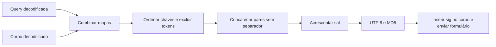

[🏠 Índice](../README.md)

# Assinatura `sig`, sal e identidade do app

## Glossário

| Termo | Significado neste projeto |
|---|---|
| `sig` | Digest hexadecimal MD5 calculado a partir dos parâmetros móveis e de um sufixo fixo. |
| Canonicalização | Regra determinística para transformar parâmetros em uma única string. |
| `canonical` | String resultante dos pares `chave=valor`, ordenados e concatenados. |
| Preimage | Conteúdo que entra no hash: aqui, bytes UTF-8 de `canonical + SIG_SALT`. |
| Sal (`SIG_SALT`) | Sufixo usado pelo esquema de assinatura observado nessa identidade do app. |
| `client_key` | Identificador de cliente enviado no corpo; é diferente do sal. |
| `__NS_sig3` / `__NStokensig` | Campos derivados do app, excluídos do cálculo de `sig`; não implementados no coletor. |

O nome “assinatura” é o nome do campo do protocolo. Não é assinatura digital
assimétrica, não é HMAC e não é criptografia que esconda o corpo. MD5 não é uma
escolha recomendada para projetar autenticação nova; é a reprodução de um
protocolo externo para as operações observadas.

O sal daqui também não é o salt aleatório por senha usado em armazenamento de
senhas. É uma constante de compatibilidade. Conhecer `sig` ou o sal não cria
uma sessão autenticada nem garante autorização em outras rotas.

## Fonte de verdade

| Constante | Valor atual | Onde vive |
|---|---|---|
| `APP_VERSION` | `10.3.20.539600` | `src/infrastructure/app_identity.py` |
| `CLIENT_KEY` | `3c2cd3f3` | Mesmo módulo. |
| `SIG_SALT` | `382700b563f4` | Mesmo módulo. |
| `APP_USER_AGENT` | `kwai-android` | Mesmo módulo. |

Esses valores formam a identidade de referência do Kwai Lite. O sal foi validado
funcionalmente para essa versão. Não foi provado que qualquer atualização exija
sal novo nem que o mesmo sal funcione para toda versão. Atualizar `appver` sem
validar o conjunto pode quebrar a compatibilidade.

[`compute_sig`](../../src/infrastructure/signature.py) importa `SIG_SALT`; não o lê
do `.env`, não recebe sal como argumento e não chama o app. Não mantenha uma
segunda implementação da fórmula em outro módulo.

## Fórmula exata implementada

```text
params = query + body, como um mapa de strings
excluded = {"sig", "__NS_sig3", "__NStokensig"}
canonical = concatenação de chave + "=" + valor
            para chaves ordenadas, exceto excluded
preimage = UTF-8(canonical + SIG_SALT)
sig = MD5(preimage), em hexadecimal minúsculo (32 caracteres)
```



### Regras que não podem ser simplificadas

1. **Query e corpo participam.** Os adapters usam `{**query, **body}`. Se uma chave
   estiver em ambos, o valor do corpo vence nesse merge Python; não há suporte a
   parâmetros repetidos como multimap. Não introduza sobreposição sem nova prova.
2. **A ordem é por chave.** Não é a ordem da URL capturada nem a ordem do dicionário.
3. **Não há `&`, vírgula, espaço ou quebra de linha entre os pares.** O `=` de
   cada par permanece. Não hasheie o resultado de `urlencode` ou um JSON.
4. **Os valores já devem estar decodificados.** A função não executa URL decode.
   Ao importar uma captura, use um parser de query/form que preserve valores
   vazios. `preloadSource=` e `pcursor=` ainda participam como valores vazios.
5. **Nomes e valores são sensíveis à grafia.** `photoId` não é `photo_id`;
   `rootCommentId` não é `commentId`; `"false"` não é `"False"`.
6. **A exclusão é exata.** Só os três nomes declarados são removidos. Não retire
   genericamente toda chave que começar com `__NS`.
7. **Assine depois de montar os dados finais.** Alterar cursor, count, timestamp,
   versão ou corpo após o hash deixa o digest desconectado da requisição.

Host, caminho, método HTTP e headers não são acrescentados por `compute_sig`.
Isso descreve esta fórmula, não uma garantia sobre outros assinadores ou rotas.

## Exemplo offline

Este exemplo usa dados fictícios, não uma requisição móvel suficiente para coletar:

```python
import hashlib

from src.infrastructure.app_identity import SIG_SALT
from src.infrastructure.signature import compute_sig

params = {"count": "2", "kpn": "KWAI", "pcursor": "", "photoId": "123"}
canonical = "count=2kpn=KWAIpcursor=photoId=123"
expected = hashlib.md5((canonical + SIG_SALT).encode("utf-8")).hexdigest()
assert compute_sig(params) == expected
assert compute_sig({**params, "sig": "ignorado", "__NS_sig3": "ignorado"}) == expected
print(expected)
```

O hash correto dessa amostra comprova apenas que a função segue a fórmula. Para
provar compatibilidade, é preciso um vetor independente capturado do app e,
se autorizado, uma resposta real da rota alvo.

## Da assinatura ao envio

O adapter monta os valores como strings; `_signed_query()` copia o contexto
base, gera `timestamp` em milissegundos e um UUID novo para `session_id` nas
rotas de contexto completo. O perfil mínimo não usa esse helper.

Depois de calcular `sig`, o envio usa `params=query` e `data=body` no HTTPX:
query na URL e corpo form-urlencoded, não JSON. A codificação de transporte
acontece depois da canonicalização.

Na mesma chamada lógica, fallback e retry reutilizam os mapas assinados,
inclusive timestamp e sessão. Eles não regeneram assinatura a cada host ou
rodada. A próxima página monta uma nova requisição e inclui o novo cursor no hash.

## Por que não implementar `__NS_sig3` agora

As operações atuais foram observadas funcionando anonimamente sem esse campo.
A investigação mais recente encontrou entradas de `atlasSign` maiores que
`caminho + sig`; essa expressão não é uma fórmula comprovada. O coletor não
reproduz o algoritmo nativo nem correlacionou completamente sua saída com o
token enviado. Artigos sobre outros builds não suprem essa prova.

Se uma rota mudar, primeiro confirme a requisição e compare com o app da mesma
versão. Não adicione um token copiado, um serviço pago ou um daemon nativo como
“correção” automática. Isso muda o contrato operacional do projeto.

## Evidências e testes

| Evidência | O que demonstra | O que não demonstra |
|---|---|---|
| Vetor real em `tests/test_mobile_api.py` | Match do digest do request capturado: `a1f8385e9b1e3ac7006c4b9d84be2014`. | Que o servidor estará disponível amanhã. |
| Teste de exclusão dos tokens | `sig3` não modifica o digest calculado. | Algoritmo ou validade de `sig3`. |
| Teste de ordenação e alteração de parâmetro | Determinismo e sensibilidade à entrada. | Validação de todos os contextos possíveis. |
| Teste de versão × contexto | Identidade e vetor de referência não mudam independentemente sem acusar divergência. | Derivação automática de um sal novo. |
| Capturas de outubro/2026 | Nove requests comparados com match; três chamadas de `CPU.getClock`, modo 30, iguais a MD5 da entrada mais o sal conhecido. | Extração literal do sal do binário ou garantia para outros builds. |

As capturas compartilháveis foram sanitizadas; não preservam todos os preimages
originais para recalcular esses nove hashes offline. O vetor versionado é a
regressão independente disponível no pacote. Veja [Pesquisa](../maintenance/research.md).

O procedimento de atualização está em [Manutenção](../maintenance/maintenance.md);
os campos por rota estão em [Protocolo móvel](./mobile-api.md).
