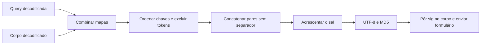

[🏠 Índice](../README.md)

# Assinatura `sig`, sal e identidade do app

## Glossário

| Termo | Significado neste projeto |
|---|---|
| `sig` | Digest hexadecimal MD5 calculado a partir dos parâmetros móveis e de um sufixo fixo. |
| Canonicalização | Regra determinística que transforma os parâmetros numa única string. |
| `canonical` | String resultante dos pares `chave=valor`, ordenados e concatenados. |
| Preimage | O que entra no hash: os bytes UTF-8 de `canonical + SIG_SALT`. |
| Sal (`SIG_SALT`) | Sufixo usado pelo esquema de assinatura observado nessa versão do app. |
| `client_key` | Identificador de cliente enviado no corpo; é diferente do sal. |
| `__NS_sig3` / `__NStokensig` | Campos que o app acrescenta depois de assinar; ficam fora do cálculo e não são implementados aqui. |

“Assinatura” é o nome do campo no protocolo. Não é assinatura digital
assimétrica, não é HMAC e não esconde o corpo. MD5 não é uma escolha
recomendada para projetar autenticação nova; aqui é só a reprodução de um
protocolo externo nas operações observadas.

O sal também não é o salt aleatório usado para guardar senhas. É uma constante
de compatibilidade. Conhecer `sig` ou o sal não cria sessão autenticada nem
garante autorização em outras rotas.

## Fonte de verdade

| Constante | Valor atual | Onde vive |
|---|---|---|
| `APP_VERSION` | `10.3.20.539600` | [`kwai_collector/client.py`](../../kwai_collector/client.py) |
| `CLIENT_KEY` | `3c2cd3f3` | Mesmo módulo. |
| `SIG_SALT` | `382700b563f4` | Mesmo módulo. |
| User-Agent móvel | `kwai-android` | `APP_HEADERS`, mesmo módulo. |

Esses valores formam a identidade de referência do Kwai Lite e valem
**juntos**. O sal foi validado para essa versão. Assinar com outra versão
(medido com `appver` 13.7) é rejeitado com `result: 50`
(*Failed to verify the signature*). Não foi provado que toda atualização exija
sal novo, nem que o mesmo sal funcione para qualquer versão.

`create_signature` lê `SIG_SALT` do próprio módulo: não lê do `.env`, não
recebe o sal como argumento e não chama o app. Não mantenha uma segunda
implementação da fórmula em outro módulo.

## Fórmula exata implementada

```text
params    = query + body, como um mapa de strings
excluded  = {"sig", "__NS_sig3", "__NStokensig"}
canonical = concatenação de chave + "=" + valor
            para as chaves em ordem alfabética, exceto excluded
preimage  = UTF-8(canonical + SIG_SALT)
sig       = MD5(preimage), em hexadecimal minúsculo (32 caracteres)
```



### Regras que não podem ser simplificadas

1. **Query e corpo participam.** `post_mobile` usa `{**query, **body}`. Se uma
   chave aparecer nos dois, vale a do corpo nesse merge. Não há suporte a
   parâmetros repetidos.
2. **A ordem é por chave.** Não é a ordem da URL capturada nem a do dicionário.
3. **Não há `&`, vírgula, espaço ou quebra de linha entre os pares.** O `=` de
   cada par fica. Não faça o hash de `urlencode` nem de um JSON.
4. **Os valores precisam estar decodificados.** A função não faz URL decode. Ao
   importar uma captura, use um parser que preserve valores vazios:
   `preloadSource=` e `pcursor=` participam como string vazia.
5. **Nomes e valores diferenciam grafia.** `photoId` não é `photo_id`;
   `rootCommentId` não é `commentId`; `"false"` não é `"False"`.
6. **A exclusão é exata.** Só os três nomes acima são removidos. Não retire toda
   chave que começar com `__NS`.
7. **Assine depois de montar os dados finais.** Mudar cursor, count, timestamp,
   versão ou corpo depois do hash deixa a assinatura inválida.

Host, caminho, método HTTP e headers não entram no cálculo.

## Exemplo offline

Este exemplo usa dados fictícios, que não bastam para uma coleta real:

```python
import hashlib

from kwai_collector.client import SIG_SALT, create_signature

params = {"count": "2", "kpn": "KWAI", "pcursor": "", "photoId": "123"}
canonical = "count=2kpn=KWAIpcursor=photoId=123"
expected = hashlib.md5((canonical + SIG_SALT).encode("utf-8")).hexdigest()
assert create_signature(params) == expected
assert create_signature({**params, "sig": "ignorado", "__NS_sig3": "ignorado"}) == expected
print(expected)
```

Esse exemplo só mostra que a função segue a fórmula. Para provar
compatibilidade, é preciso um vetor independente capturado do app e, se
autorizado, uma resposta real da rota.

## Da assinatura ao envio

`scraper.py` monta os valores como strings. `build_app_query()` copia
`APP_QUERY` e acrescenta `timestamp` em milissegundos e um UUID novo em
`session_id`, nas rotas de contexto completo. O feed de perfil usa só
`kpn` e `appver`.

`post_mobile` calcula o `sig` uma vez, coloca no corpo e envia com
`params=query` e `data=body` no HTTPX: query na URL e corpo form-urlencoded,
não JSON. A codificação de transporte acontece depois da canonicalização.

Dentro da mesma chamada, a troca de host e o retry reaproveitam os mapas
assinados, inclusive timestamp e sessão; não há nova assinatura a cada host ou
rodada. A próxima página monta uma requisição nova, com o novo cursor no hash.

## Por que não implementar `__NS_sig3`

As operações atuais funcionam anonimamente sem esse campo. A investigação do
app encontrou entradas da rotina nativa (`atlasSign`) maiores que
`caminho + sig`; essa expressão não é uma fórmula comprovada. O coletor não
reproduz esse algoritmo.

Se uma rota mudar, primeiro confirme a requisição e compare com o app da mesma
versão. Não adicione um token copiado, um serviço pago ou um processo nativo
como “correção” automática: isso mudaria o contrato operacional do projeto.

## Evidências e testes

| Evidência | O que demonstra | O que não demonstra |
|---|---|---|
| Vetor real em [`tests/test_client.py`](../../tests/test_client.py) (`test_sig_igual_ao_do_app`) | O digest de um request capturado do app bate: `a1f8385e9b1e3ac7006c4b9d84be2014`. | Que o servidor estará disponível amanhã. |
| `test_sig_ignora_tokens_extras` | `__NS_sig3` não muda o digest calculado. | O algoritmo ou a validade de `sig3`. |
| `test_tenta_o_proximo_host_quando_um_falha` | O corpo enviado contém `sig`. | A aceitação pelo servidor real. |
| Investigação de outubro/2026 | Nove requests comparados com match do `sig`. | Garantia para outras versões do app. |

O teste do vetor real usa o digest capturado como valor esperado. Ele **não**
deve ser recalculado com `create_signature`, senão testaria a função contra ela
mesma.

O procedimento de atualização está em [Manutenção](../maintenance/maintenance.md);
os campos por rota, em [Protocolo móvel](./mobile-api.md); o histórico, em
[Pesquisa](../maintenance/research.md).
