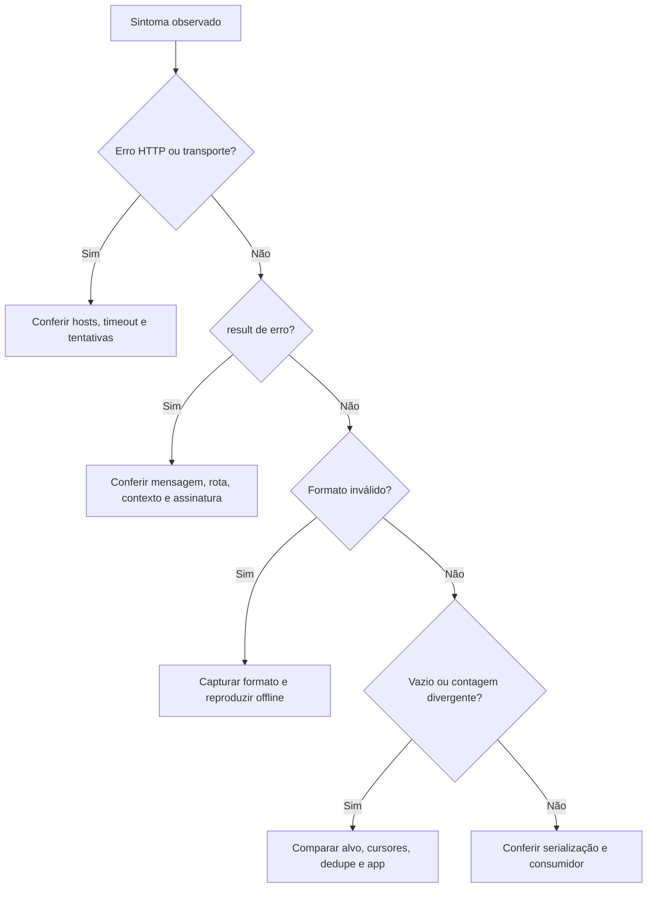
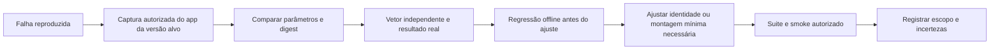

[🏠 Índice](../README.md)

# Guia de manutenção

## Escopo

Este runbook adapta a manutenção dos experimentos à implementação atual.
Não manda restaurar Nuxt, instalar um signer nativo ou chamar scripts `_invest/`
que não existem neste pacote. A manutenção deve preservar coleta sem login,
assinatura local, contrato JSON e dependências atuais, salvo decisão explícita
de mudar esses requisitos.

Os passos de diagnóstico e captura são procedimentos para o mantenedor, não
rotinas automáticas já implementadas. Não há monitor, scheduler ou serviço de
alerta instalado por esta documentação.

## Mapa de manutenção

| Se mudar… | Examinar primeiro | Conferir depois |
|---|---|---|
| Versão, chave ou sal | `infrastructure/app_identity.py` | Assinatura, contextos e vetor em `test_mobile_api.py`. |
| Corpo/query de uma rota móvel | `infrastructure/mobile_client.py` | Todos os parâmetros assinados; nomes, valores vazios e contexto por rota. |
| Host/status/retry | `mobile_client.py`, `web_client.py`, `http_utils.py` | Ordem, número de tentativas, rate limit e não-retry de negócio. |
| Campos recebidos | `mapping.py`, `http_utils.py` | Schemas, tolerância, páginas anteriores e fixtures sanitizadas. |
| Limites/cursor/dedupe | `application/`, `domain/identity.py`, `Cursor` | Políticas diferentes de busca, perfil, raízes e respostas. |
| Saída/diagnóstico | `entrypoints/export_commands.py`, `export_files.py`, modelos | JSON normal/parcial, exit code, arquivos UTF-8 e erro de escrita. |
| Recursos HTTP | `container.py`, adapters | Fechamento em sucesso, erro e falha de `close()`. |

Não mova assinatura para o domínio: é conhecimento técnico da API externa.
Uma troca de camada ou contrato precisa de avaliação própria, não de um ajuste
casual no runbook. Consulte [Arquitetura](../internals/architecture.md).

## 1. Diagnóstico inicial: preservar evidência

Antes de modificar sal ou contexto, registre:

| Dado | Por quê |
|---|---|
| Versão do coletor e do Python | Reproduzir a implementação que falhou. |
| Comando/opções e timestamp UTC | Separar execução, alvo e período. |
| Configuração efetiva não sensível | Entender retries, delay e timeout. |
| Rota, host, status HTTP | Separar web/móvel e gateway degradado. |
| `result`, mensagem original, contagens e cursor de fim | Distinguir negócio, formato e fim informado. |
| Existência de parcial e exit code | Evitar tratar a coleta como completa. |
| Versão/build/pacote do app, se houver comparação | Não misturar receitas de builds diferentes. |

Use `--verbose` para ampliar logs. Os erros originais podem conter URLs:
revise a saída antes de compartilhá-la. Não grave headers de autenticação,
cookies, identificadores reais de device ou preimages completos em issues públicas.
Não suponha que um arquivo JSON existente foi produzido pela execução mais recente.

## 2. Classificar a falha



| Sinal | O que se pode concluir | Próxima verificação |
|---|---|---|
| `result: 50` | Rejeição compatível com verificação de assinatura; causa exata não determinada. | Mapas finais, canonicalização, identidade e vetor do app. |
| `result: 11` | Erro de negócio, não prova isolada de internet ruim, login ou contexto específico. | Rota, nomes/tipos, parâmetros e comparação com request válido. |
| `result: 40` | Erro de negócio; falta de `client_key` já produziu esse código em experimentos. | Presença/compatibilidade da chave e corpo; não inferir expiração ou busy só pelo código. |
| Outro `result` | Sem significado deduzido pelo coletor além do erro recebido. | Preservar mensagem e obter evidência; não inventar mapeamento de códigos. |
| HTML/não-objeto na resposta móvel | Gateway não entregou objeto JSON aceito. | Fallbacks e falhas finais; não confundir com lista interna inválida. |
| Lista/item/cursor inválido | Mudança ou dado inesperado no protocolo. | Fixture e teste de erro/partial; não repetir indefinidamente. |
| Um gateway lento | Problema nessa chamada/host, ainda sem diagnóstico universal. | Logs de fallback e comparação controlada, sem mudar todos os hosts. |
| Todos os hosts falham | Escada esgotada; causa local ou remota ainda desconhecida. | DNS, TLS, conectividade, status, indisponibilidade e contexto do período. |
| Lista vazia | Dados não entregues nessa combinação, ou mapeamento descartou feeds. | Alvo, contexto, campos, logs de mapping e cursor; não declarar quebra automaticamente. |
| 59 declaradas e 52 coletadas | Discrepância observada; não prova sete itens perdidos pelo coletor. | Itens únicos, fim da sublista e comparação com o app. |

As orientações da CLI para `50`, `11`, `40` dizem “causa exata não determinada”.
Não substitua esse cuidado por diagnósticos categóricos dos documentos antigos.

## 3. Verificações offline

Na raiz do projeto:

```bash
poetry run ruff check .
poetry run ruff format --check .
poetry run mypy src
poetry run pytest
poetry run pytest --cov=src --cov-report=term-missing
```

| Mudança | Testes prioritários |
|---|---|
| Assinatura, versão ou corpo móvel | `tests/test_mobile_api.py`. |
| Request/response de perfil e comentário | `tests/test_mobile_captures.py`, `tests/test_collector.py`. |
| JSON inválido e cursores | `tests/test_response_validation.py`, `tests/test_pagination.py`. |
| Limites, dedupe, parcial e divergência de total | `tests/test_usecases.py`. |
| Texto, métricas, datas, URLs e vínculos | `tests/test_parsers.py`, `tests/test_domain.py`. |
| CLI, erros da API e escrita de parcial | `tests/test_cli.py`, `tests/test_cli_exports.py`. |
| Composição e uso do context manager | `tests/test_collector.py`; `tests/test_cli_exports.py` simula falha de fechamento na CLI nova. |
| Contrato e amostras | `tests/test_models.py`, `tests/test_samples.py`. |

Exemplo de regressão focada:

```bash
poetry run pytest tests/test_mobile_api.py tests/test_mobile_captures.py tests/test_response_validation.py
```

Teste novo deve reproduzir a falha observada antes do reparo. Para falhas de
paginação, simule a primeira e uma página posterior, confira o parcial e o que
acontece com as outras raízes/palavras. Não afrouxe o modelo para fazer uma
fixture malformada passar. Não dependa de rede para o teste de regressão.

## 4. Smoke ao vivo, quando autorizado

Escolha uma palavra, um perfil e uma postagem públicos conhecidos. Use poucos
itens e caminhos exclusivos da execução. Estes comandos fazem requisições reais:

Os exemplos abaixo exportam para pastas por perfil/execução. Para coleta
combinada e opções, consulte [CLI](../guides/cli.md).

```bash
poetry run kwai-collector search -k sports -l 2 -v -o exports/smoke
poetry run kwai-collector profile -u @parkourcity -l 2 -v -o exports/smoke
poetry run kwai-collector comments --url "https://www.kwai.com/@parkourcity/video/5240651225143682227" -l 2 -v -o exports/smoke
poetry run kwai-collector comments --url "https://www.kwai.com/@parkourcity/video/5240651225143682227" -l 2 --with-comments-replies -v -o exports/smoke
```

Confirme o código de saída **de cada comando**, campos essenciais, contagem,
tipo dos itens e warnings. A expansão só exercita `sublist` se houver uma raiz
com id e total de respostas truthy; duas raízes sem respostas não testam essa rota.
O limite das raízes não limita o tamanho das sublistas, portanto escolha alvos
com volume adequado. Não coloque um target frágil como obrigação de lista não
vazia em CI: indisponibilidade e ausência de conteúdo são cenários diferentes.

Testes offline aprovados + smoke válido são evidências complementares. Nenhum
dos dois garante que todos os comentários existentes tenham sido entregues.

## 5. Atualizar versão, contexto ou sal

Não há comando neste pacote que descubra automaticamente o próximo sal.
Um digest MD5 e um request incompleto não permitem recuperar de forma garantida
a string secreta/sufixo usada por uma versão desconhecida.



### Coleta da evidência no laboratório

1. Use ambiente próprio/autorizado, app e build identificados. Ferramentas de
   inspeção como ADB, Frida ou descompilação são opcionais no laboratório, não
   uma dependência a acrescentar ao coletor.
2. Capture uma chamada real da operação alvo: método, path, query, corpo,
   nomes dos campos, valores vazios, digest e resposta. Ausência de tráfego
   capturado não prova proteção anti-instrumentação: pode ser processo errado,
   sessão antiga, cache ou ausência de ação na UI.
3. Compare os mapas **decodificados** com o que o adapter constrói. Não misture
   web/internacional, Kuaishou chinês, Kwai Lite, arm32 e outros builds.
4. Recalcule o digest conhecido antes de sanitizar o preimage. Verifique pares
   vazios, UTF-8, ordenação, exclusões e o merge query/corpo.
5. Se não casar, primeiro descarte diferenças de parâmetros. Se for necessário
   estudar a rotina do app, obtenha a entrada e saída do cálculo e valide um
   candidato a sal independentemente. Um match para o sal conhecido confirma
   esse candidato; não significa extração literal da constante do binário.
6. Compare resposta do app com resposta de uma requisição equivalente apenas
   nas condições autorizadas. Mantenha o laboratório separado do fluxo de produção.

Não há hooks ou comandos `_invest/hook_cpua.py` instalados nesta árvore. Nomes
obfuscados, offsets e instruções antigas de anexação não são uma API estável;
precisam ser redescobertos para o build sendo investigado.

### Arquivos a alterar somente após prova

| Arquivo | Ajuste possível |
|---|---|
| `src/infrastructure/app_identity.py` | Versão, chave, sal, UA, se a nova evidência exigir. |
| `src/infrastructure/mobile_client.py` | Contexto ou corpo específico da rota. |
| `tests/test_mobile_api.py` | Novo vetor independente e identidade associada. |
| `tests/fixtures/` e `test_mobile_captures.py` | Regressão sanitizada de campos/cursor que mudaram. |
| Guias da assinatura, protocolo, pesquisa e README | Estado validado e limitações, sem promessas de compatibilidade universal. |

Mudar só a constante para uma versão “mais recente” não é manutenção validada.
Não derive o `expected_sig` do próprio `compute_sig` no teste do vetor real:
isso testaria a implementação contra ela mesma. Preserve o histórico da evidência,
sem deixar um teste antigo aparentemente provar o app novo.

Se a fórmula realmente mudar, ou se `sig3` passar a ser necessário, pare de
tratar isso como troca de constante. É nova investigação/decisão de contrato;
não use tokens copiados, bypass de login ou serviços externos como fallback silencioso.

## 6. Sanitizar e promover capturas

1. Guarde o bruto com controle de acesso; use `out/` apenas como área local
   ignorada, não como proteção de confidencialidade por si só.
2. Execute comparações de assinatura antes de remover identificadores/valores.
3. Para fixtures compartilháveis, conserve apenas campos necessários ao cenário.
   Remova cookies, tokens, headers de autenticação e metadados de dispositivo;
   revise também query de URLs de mídia e conteúdo com dados pessoais.
4. Indique se a lista foi recortada e se cursor/result foram preservados. Não
   substitua o total declarado pelo tamanho da amostra para “arrumar” o teste.
5. Documente origem, data, build e transformações. Não marque como byte a byte
   um payload cujas URLs/campos foram sanitizados.
6. Compare os campos mantidos com a captura original e escreva assertions com
   valores independentes. Sanitizar evita exposição; não transforma pesquisa em
   prova de completude de todos os campos.

O [README das fixtures](../../tests/fixtures/README.md) descreve os recortes móveis
versionados. O [registro de pesquisa](./research.md) resume a evidência local
sem exigir que o leitor tenha acesso às capturas brutas.

## 7. Revisão de entrega

- [ ] Identificada a falha por entrada → estado → efeito, sem diagnóstico inventado.
- [ ] Não alterado comportamento de outras rotas por copiar corpo/contexto inteiro.
- [ ] Preservados nomes/tipos de JSON e semântica de `null`/zero.
- [ ] Testado o que acontece com itens anteriores e outras unidades quando há falha.
- [ ] Vetor real independente quando identidade/assinatura muda.
- [ ] Fixtures sanitizadas, fonte e recortes identificados.
- [ ] Lint, tipos, formatação e testes sem regressão introduzida.
- [ ] Smoke registrado como observado, quando feito; não alegar validação ao vivo sem fazê-la.
- [ ] Docs e exemplos coerentes com imports atuais; nenhum comando removido ensinado como disponível.
- [ ] Somente arquivos relacionados incluídos na entrega; `.env`, `out/`, APKs e dumps fora dela.

Como rotina recomendada, reavalie as operações após uma mudança de compatibilidade,
atualização do app de referência ou relato de quebra. Não há cadência mensal
obrigatória, garantia de reparo “em minutos” ou automação instalada no projeto.
