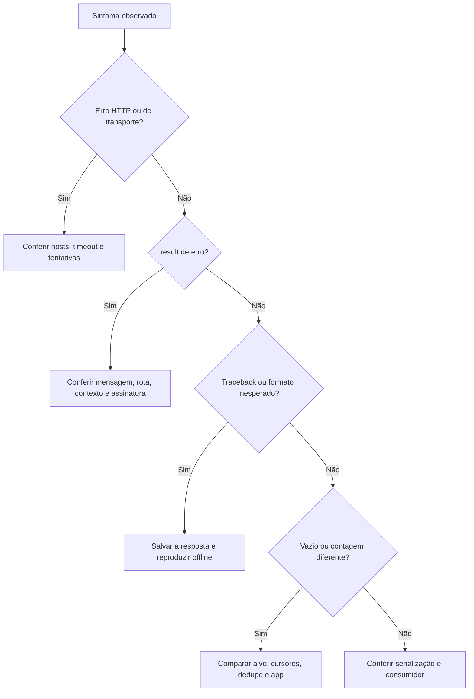

[🏠 Índice](../README.md)

# Guia de manutenção

## Escopo

Este guia orienta quem precisa diagnosticar uma falha, atualizar a versão do
app de referência ou mudar uma rota. A manutenção deve preservar a coleta sem
login, a assinatura local, o contrato JSON e as dependências atuais, salvo
decisão explícita de mudar esses requisitos (registrada numa
[ADR](../adr/README.md)).

Os passos de diagnóstico e captura são procedimentos para o mantenedor, não
rotinas automáticas. Não há monitor, agendador nem alerta instalado no projeto.

## Mapa de manutenção

| Se mudar… | Examinar primeiro | Conferir depois |
|---|---|---|
| Versão, chave ou sal do app | `APP_VERSION`, `CLIENT_KEY`, `SIG_SALT` em `client.py` | Assinatura, `APP_QUERY` e o vetor em `tests/test_client.py`. |
| Corpo ou query de uma rota móvel | Funções da rota em `scraper.py` | Todos os parâmetros assinados: nomes, valores vazios e contexto por rota. |
| Hosts, status ou retry | `MOBILE_HOSTS`, `RETRY_STATUS`, `post_json`, `with_retry`, `post_mobile` em `client.py` | Ordem dos hosts, número de tentativas, rate limit e não repetição de erro de negócio. |
| Campos recebidos | `parser.py` | [Schemas](../reference/schemas.md), conversões e fixtures. |
| Formato de URL do Kwai | `BASE_URL` em `parser.py`, `get_photo_id` em `scraper.py` | URLs montadas e extração do id. |
| Limites, cursor ou dedupe | `next_cursor`, `comment_key` e os laços em `scraper.py` | As políticas diferentes de busca, perfil, comentários e respostas. |
| Saída ou exit codes | `collect_and_save` em `cli.py`, `models.py` | JSON, UTF-8, códigos `0`/`1`/`2` e erro de escrita. |
| Configuração | `config.py`, `.env.example`, tabela do README | Padrões, validação e documentação. |

## 1. Diagnóstico inicial: preservar evidência

Antes de mexer em sal ou contexto, registre:

| Dado | Por quê |
|---|---|
| Versão do coletor e do Python | Reproduzir a implementação que falhou. |
| Comando, opções e horário UTC | Separar execução, alvo e período. |
| Configuração efetiva (`KWAI_*`) | Entender retries, delay e timeout. |
| Rota, host e status HTTP | Separar web de móvel e host degradado. |
| `result`, mensagem original, contagens e cursor de fim | Distinguir erro de negócio, formato e fim informado. |
| Código de saída | Saber se a coleta terminou. |
| Versão do app, se houver comparação | Não misturar dados de versões diferentes. |

Use `--verbose` para ver cada requisição do HTTPX. Os logs podem conter URLs
com a query completa: revise antes de compartilhar. Não publique cookies,
identificadores reais de dispositivo nem preimages completos.

## 2. Classificar a falha



| Sinal | O que se pode concluir | Próxima verificação |
|---|---|---|
| `result: 50` | Rejeição compatível com assinatura inválida; causa exata não determinada. | Mapas finais, canonicalização, versão do app e vetor. |
| `result: 11` | Erro de negócio; já apareceu no `getInfo` com contexto mínimo. | Rota, nomes e tipos dos parâmetros, contexto. |
| `result: 40` | Erro de negócio; já apareceu sem `client_key` no corpo. | Presença e valor da chave. Não inferir expiração só pelo código. |
| Outro `result` | Nada além do erro recebido. | Guardar a mensagem e obter evidência. |
| HTML ou corpo que não é objeto JSON | Host não entregou JSON; tratado como falha passageira. | Logs de troca de host e falha final. |
| Traceback de `AttributeError`/`KeyError` no scraper | A estrutura de uma lista mudou; o código não valida o formato. | Salvar a resposta, criar fixture e ajustar o scraper. |
| Um host lento | Problema nesse host; ainda sem diagnóstico geral. | Logs de troca de host. |
| Todos os hosts falham | Causa local ou remota ainda desconhecida. | DNS, TLS, conectividade, status e período. |
| Lista vazia | Nada entregue nessa combinação, ou o parser descartou os feeds. | Alvo, campos, warnings `post ignorado` e cursor. |
| 59 respostas declaradas e 52 coletadas | Diferença observada; não prova itens perdidos pelo coletor. | Itens únicos, fim da sublista e comparação com o app. |

## 3. Verificações offline

Na raiz do projeto:

```bash
poetry run ruff check .
poetry run ruff format --check .
poetry run mypy
poetry run pytest
```

| Mudança | Testes prioritários |
|---|---|
| Assinatura, versão ou troca de host | `tests/test_client.py`. |
| Retry, status e erro de negócio | `tests/test_client.py`. |
| Corpo das rotas, paginação e dedupe | `tests/test_cli.py`. |
| Texto, métricas, datas, URLs | `tests/test_parser.py`. |
| Contrato e amostras | `tests/test_samples.py`, `tests/test_parser.py`. |
| Exit codes e escrita | `tests/test_cli.py`. |

Os testes não usam rede: o HTTP é simulado com `respx` e
[`tests/conftest.py`](../../tests/conftest.py) zera o delay, desliga o
backoff e limita `max_retries` a 1.

Teste novo deve reproduzir a falha observada antes do reparo. Não afrouxe o
modelo para uma fixture malformada passar.

## 4. Smoke ao vivo

Escolha uma palavra, um perfil e uma postagem públicos conhecidos. Use poucos
itens. Estes comandos fazem requisições reais:

```bash
poetry run kwai-collector search -k sports -l 2 -v -o out/smoke/busca.json
poetry run kwai-collector profile -u @parkourcity -l 2 -v -o out/smoke/usuario.json
poetry run kwai-collector comments --url "https://www.kwai.com/@parkourcity/video/5240651225143682227" -l 2 -v -o out/smoke/comentarios.json
poetry run kwai-collector comments --url "https://www.kwai.com/@ajudantedoreid/video/5210251923800764971" -l 1 --with-replies -v -o out/smoke/respostas.json
```

Confira o código de saída **de cada comando**, os campos essenciais, a
contagem e os warnings. A expansão só exercita `sublist` se algum comentário
principal tiver id e respostas declaradas; o último exemplo usa um post que
tinha respostas na data da verificação. Um alvo de exemplo pode mudar: não
transforme “lista não vazia” em teste automático.

Testes offline aprovados e smoke válido são evidências complementares. Nenhum
dos dois garante que todo o conteúdo existente foi entregue.

## 5. Atualizar versão, contexto ou sal

Não há comando no projeto que descubra o próximo sal. Um digest MD5 e um
request incompleto não permitem recuperar o sufixo usado por uma versão
desconhecida.

```mermaid
flowchart LR
    Failure[Falha reproduzida] --> Capture[Captura autorizada do app da versão alvo]
    Capture --> Compare[Comparar parâmetros e digest]
    Compare --> Evidence[Vetor independente e resposta real]
    Evidence --> Test[Teste de regressão antes do ajuste]
    Test --> Change[Ajustar constantes ou montagem da rota]
    Change --> Check[Suíte e smoke]
    Check --> Record[Registrar escopo e incertezas]
```



### Coleta da evidência

1. Use ambiente próprio ou autorizado, com app e versão identificados. ADB,
   Frida ou descompilação são ferramentas de laboratório, não dependências a
   acrescentar ao coletor.
2. Capture uma chamada real da operação alvo: método, caminho, query, corpo,
   valores vazios, digest e resposta.
3. Compare os mapas **decodificados** com o que `scraper.py` monta. Não misture
   versões nem variantes do app.
4. Recalcule o digest antes de sanitizar a captura. Confira pares vazios,
   UTF-8, ordenação, exclusões e o merge de query e corpo.
5. Se não bater, primeiro descarte diferenças de parâmetros. Um match com um
   sal candidato confirma esse candidato; não é extração literal do binário.

### Arquivos a alterar somente após prova

| Arquivo | Ajuste possível |
|---|---|
| `kwai_collector/client.py` | `APP_VERSION`, `CLIENT_KEY`, `SIG_SALT`, `APP_QUERY`, `APP_HEADERS`. |
| `kwai_collector/scraper.py` | Contexto ou corpo de uma rota. |
| `tests/test_client.py` | Novo vetor real (`QUERY`, `BODY` e digest esperado). |
| `tests/fixtures/` | Nova resposta recortada, se os campos mudaram. |
| `docs/` e README | Estado validado e limitações. |

Trocar só a constante para uma versão mais nova não é manutenção validada. O
digest esperado no teste do vetor real deve vir da captura, nunca de
`create_signature`. Se a fórmula mudar, ou se `sig3` passar a ser exigido, isso
é uma nova investigação e uma nova ADR, não uma troca de constante.

## 6. Sanitizar capturas antes de virar fixture

1. Guarde a captura bruta fora do repositório.
2. Faça as comparações de assinatura antes de remover identificadores.
3. Mantenha só os campos que o teste usa. Remova cookies, tokens, headers de
   autenticação, identificadores de dispositivo e URLs de mídia.
4. Indique se a lista foi recortada e preserve `result` e `pcursor`. Não troque
   o total declarado pelo tamanho da amostra.
5. Registre origem, data e versão em
   [`tests/fixtures/README.md`](../../tests/fixtures/README.md).

## 7. Revisão de entrega

- [ ] Falha descrita por entrada → estado → efeito, sem diagnóstico inventado.
- [ ] Corpo e contexto de outras rotas não foram alterados por cópia.
- [ ] Nomes e tipos do JSON preservados, assim como a diferença entre `null` e zero.
- [ ] Vetor real independente quando versão ou assinatura mudam.
- [ ] Fixtures sanitizadas, com origem registrada.
- [ ] `ruff check`, `ruff format --check`, `mypy` e `pytest` sem erros.
- [ ] Smoke registrado como observado, quando feito.
- [ ] Docs e exemplos coerentes com o código.
- [ ] `.env`, `out/` e capturas brutas fora da entrega.
