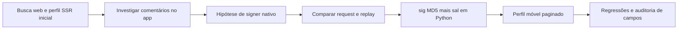

[🏠 Índice](../README.md)

# Pesquisa, proveniência e limites da evidência

## Como os documentos de experimentos foram adaptados

Esta documentação é uma **cópia adaptada do conhecimento**, não um espelho literal
dos arquivos de laboratório. Os originais ficam preservados fora do pacote;
os guias daqui podem ser lidos sem essa pasta. Não foram copiados código de
experimentos, capturas brutas, dependências nem comandos de protótipos removidos.

| Documento original em `experimentos/docs/` | Conteúdo aproveitado | Destino/adaptação |
|---|---|---|
| `solucao_api_movel_anonima.md` | Descoberta móvel, sig, corpos, gateways, paginação e runbook. | [Assinatura](../internals/signature.md), [Protocolo](../internals/mobile-api.md), [Manutenção](./maintenance.md). Caminhos e política de fallback atualizados. |
| `schemas.md` | Campos do JSON e extensão de respostas. | [Schemas](../reference/schemas.md). Nomes Python atuais e perfil móvel no lugar de SSR. |
| `pesquisa_engenharia_kwai.md` | Trajetória web → investigação do app → HTTP puro. | Histórico abaixo; removidas generalizações sobre intenção do servidor, segurança e completude. |
| `opcoes_sem_emulador_2026.md` | Alternativas avaliadas e correção para sig local. | Contexto histórico, não recomendação de browser, proxy ou API paga. |
| `solucao_unidbg_emulacao_nativa.md` | Protótipo de emulação e assinatura via app. | Registro de alternativa abandonada, sem ensinar um serviço inexistente como solução pronta. |
| `pesquisa_unidbg_sig3_estado_2026.md` | Limites da reprodução nativa e diferenças de builds. | Distinção entre literatura sobre sig3 e evidência disponível para o coletor. |
| `arquitetura_isolamento_servico_so.md` | Separação entre laboratório e runtime. | Princípio mantido; pipeline de `.so` e daemon não adotados. |

Os artigos, preços, contagens de estrelas e receitas de terceiros citados nos
originais não foram revalidados nesta adaptação. Não são requisitos nem prova
de funcionamento no Kwai Lite de referência. O código atual prevalece quando
contradiz um documento de pesquisa.

## Evolução da solução

| Etapa | Aprendizado | Estado atual |
|---|---|---|
| Web/SSR | Perfil embutido no HTML ajudou a primeira coleta, mas não resolveu paginação. | Parser Nuxt removido; perfil vem de `getInfo` + `feed/profile`. |
| Comentários web | Chamadas anônimas examinadas não entregaram a lista esperada. | Não há fallback web de comentários nem fluxo de login. |
| Acessibilidade do app | Texto podia ser visto, mas leitura de UI exigia automação frágil. | Não integra o runtime. |
| Frida como signer | Reutilização do app permitiu explorar requests e assinadores. | Só investigação; não há RPC/daemon de assinatura no pacote. |
| Unidbg | O protótipo histórico não gerou assinatura utilizável para o build alvo; init/sign retornavam nulo. | Rota abandonada; nenhuma JVM ou `.so` requerida. |
| Replay sem sig3 | Request válido funcionou com sig calculado em Python. | Método adotado. |
| Perfil móvel | Resolução de handle e cursor permitem coleta paginada sem SSR. | Implementado. |

Não foi necessário reproduzir toda a segurança do app para essas operações.
A existência de `sig3` no request não prova que ele seja exigido pela rota.
A impossibilidade de um protótipo Unidbg funcionar também não prova impossibilidade
matemática de reproduzir um algoritmo.

## Evidências de outubro/2026

A investigação local de 07/10/2026 usou Kwai Lite `10.3.20.539600`. Os números
abaixo vêm dos relatórios sanitizados produzidos nessa investigação, não de uma
nova captura executada na elaboração desta documentação.

| Verificação | Resultado observado | Alcance |
|---|---|---|
| Assinatura do request | 9 checks HTTP, 9 matches do `sig`. | Requests observados, não todas as rotas/versões. |
| Rotina nativa | 3 chamadas de `CPU.getClock`, modo 30, iguais a `MD5(entrada + sal conhecido)` e diferentes de `MD5(entrada)`. | Prova funcional desse candidato; não extração literal do sal da `.so`. |
| Campos de postagens | 90 posts únicos; relatório registra 720 verificações de campos no conjunto analisado. | Campos examinados; não payload inteiro. |
| Comentários | 30 ocorrências de raiz, 20 únicas; 6 respostas únicas e 12 checks de vínculo. | Nenhuma divergência registrada no conjunto comparado. Previews não foram comparados. |
| Smoke anônimo | Resolução de usuário, 30 posts, 50 raízes e 52 respostas; sem autenticação e sem sig3. | Alvos e momento observados. |
| Contagem de respostas | Raiz declarava 59; sublista entregou 52 e fim. | Causa da diferença não determinada; sem prova de completude. |
| Cursor inicial da sublista | Vazio e `fetch_from_begin` retornaram as mesmas 52 e fim no teste desse alvo. | O coletor mantém cursor vazio; não cria fallback de cursor por isso. |

Os relatórios locais ficam em `out/frida-audit-20261007-174633/`, ignorado pelo
Git, e podem não existir em outro checkout. Os exemplos permanentes estão em
[`tests/fixtures`](../../tests/fixtures), com testes em
[`test_mobile_captures.py`](../../tests/integration/test_mobile_captures.py).

Fixtures são recortes: dois itens por página de comentários/perfil, três respostas.
Preservam campos escolhidos e cursores, mas não representam páginas completas.
Queries de mídia e dados sensíveis foram removidos; os preimages íntegros não
estão disponíveis nas capturas compartilháveis para recalcular tudo offline.

## Conclusões antigas que não devem ser transportadas

| Afirmação anterior | Formulação mantida neste pacote |
|---|---|
| “`sig3 = atlasSign(path + sig)`” | Entradas observadas foram maiores; fórmula de sig3 não reproduzida. |
| “Perfil recusa sempre contexto completo” | O app retornou feeds com completo; o coletor preserva o mínimo validado. |
| “`result: 40` significa timestamp expirado depois de 60 segundos” | Não há prova suficiente de janela universal nem diagnóstico só pelo código. |
| “Se todos os hosts falham, o problema é local” | Causa pode ser local ou remota e precisa de evidência. |
| “Trocar `.so` resolve 90% das atualizações” | Estatística não sustentada para o coletor; runtime não consome `.so`. |
| “Entrega 100% dos comentários” | Entrega o que a API devolve até as condições de fim; declarado pode divergir de coletado. |
| “O código 11 prova login ou uma estratégia deliberada do WAF” | Código/mensagem orientam investigação; não provam causa ou intenção. |
| “Um match recupera um sal desconhecido” | Match confirma candidato; não inverte MD5 nem garante derivação para outra versão. |

## Questões ainda abertas

- Causa das sete respostas não entregues no alvo de referência.
- Combinação exata por trás das respostas vazias anteriores com contexto completo.
- Algoritmo e correlação completa de saída de `atlasSign` com `__NS_sig3`.
- Compatibilidade da identidade atual com outros builds/regiões/contextos.
- `getInfo` não foi capturado naturalmente na UI da auditoria; foi exercitado
  pelo smoke do coletor. A UI observada também usava outra rota de perfil.
- Fallback semântico de `caption` para `user_text` e conversão permissiva de ids,
  descritos em [Schemas](../reference/schemas.md), não corrigidos por esta adaptação.

## Critério para transformar pesquisa em manutenção

Uma hipótese só deve virar alteração de código depois de uma comparação
reproduzível: entrada, parâmetros, estado, resultado e contraexemplo à política
existente. Preserve evidência independente e teste offline. Não acrescente
dependências ou estados só porque apareceram como proposta num relatório antigo.
Veja [Manutenção](./maintenance.md) para o procedimento detalhado.

As [ADRs](../adr/README.md) formalizam as escolhas já adotadas com alternativas
e trade-offs. Os [casos de uso](../use-cases/README.md) e as
[regras](../business-rules/README.md) descrevem o comportamento atual; não convertem
hipóteses dos experimentos em novos requisitos.
