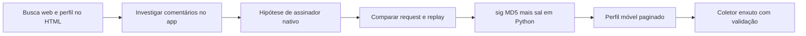

[🏠 Índice](../README.md)

# Pesquisa, evidências e limites

Este documento resume como se chegou à solução atual, o que foi medido e o que
continua sem resposta. Ele registra o conhecimento necessário para manter o
coletor; não reproduz capturas brutas nem código de laboratório.

## Evolução da solução

| Etapa | Aprendizado | Estado atual |
|---|---|---|
| Web e HTML do site | O perfil embutido no HTML ajudou na primeira coleta, mas só trazia a primeira página. | Não usado; o perfil vem de `getInfo` + `feed/profile`. |
| Comentários na web | Chamadas anônimas examinadas não entregaram a lista esperada. | Não há fallback web de comentários nem login. |
| Acessibilidade do app | O texto aparecia, mas ler a interface exigia automação frágil. | Não faz parte da coleta. |
| Frida como assinador | Usar o app permitiu observar requests e assinaturas. | Só investigação; nada disso roda na coleta. |
| Unidbg | O protótipo não gerou assinatura utilizável para a versão alvo. | Abandonado; nenhuma JVM ou `.so` é necessária. |
| Replay sem `sig3` | Um request válido funcionou com `sig` calculado em Python. | Método adotado ([ADR-0002](../adr/0002-local-signature.md)). |
| Perfil móvel | Resolver o usuário em id e paginar por cursor deu o perfil completo. | Implementado ([ADR-0001](../adr/0001-mobile-profile-and-comments.md)). |
| Coletor enxuto | As três operações cabem em módulos simples com modelos validados. | Implementado ([ADR-0003](../adr/0003-flat-modules.md)). |

Não foi preciso reproduzir toda a segurança do app nessas operações. A presença
de `sig3` no request do app não prova que a rota o exige. O fracasso de um
protótipo Unidbg também não prova que o algoritmo seja impossível de reproduzir.

## Evidências da investigação (outubro de 2026)

A investigação de 07/10/2026 usou o Kwai Lite `10.3.20.539600`.

| Verificação | Resultado observado | Alcance |
|---|---|---|
| Assinatura | 9 requests comparados, 9 matches do `sig`. | Requests observados, não todas as rotas ou versões. |
| Rotina nativa | 3 chamadas de `CPU.getClock`, modo 30, iguais a `MD5(entrada + sal conhecido)`. | Confirma o candidato a sal; não é extração literal do binário. |
| Campos de postagens | 90 posts únicos conferidos campo a campo. | Campos examinados, não o payload inteiro. |
| Comentários | 20 comentários principais únicos e 6 respostas conferidos, incluindo vínculos. | Nenhuma divergência no conjunto comparado. |
| Smoke anônimo | Usuário resolvido, 30 posts, 50 comentários principais e 52 respostas, sem autenticação e sem `sig3`. | Alvos e momento observados. |
| Contagem de respostas | Um comentário declarava 59 respostas; a sublista entregou 52 e indicou fim. | Fim de cursor sem prova de completude. |
| Versão diferente | Assinar com `appver` 13.7 e o sal atual devolveu `result: 50`. | Mostra que sal e versão andam juntos. |

As fixtures em [`tests/fixtures/`](../../tests/fixtures) são recortes dessas
respostas. O vetor real da assinatura está em
[`tests/test_client.py`](../../tests/test_client.py).

## Verificação deste coletor (09/10/2026)

Execuções reais com a CLI atual, com a configuração padrão:

| Comando | Resultado |
|---|---|
| `search --keyword eleicoes --limit 50` | 50 posts, exit `0`. |
| `search --keyword sports --limit 200` | 200 posts únicos em 4 páginas, exit `0`. |
| `search --keyword xqzvbnmparkourxyz --limit 200` | 29 posts; a 2ª página repetiu todos e a busca parou, exit `0`. |
| `profile --user @parkourcity --limit 100` | 100 posts, exit `0`. |
| `profile --user @parkourcity` (sem limite) | 7.389 posts, sem duplicatas, em cerca de 6 minutos, exit `0`. |
| `comments --url .../video/5240651225143682227` | 15 comentários, igual ao `comentarios` do engajamento do post, exit `0`. |
| `comments ... --limit 3 --with-replies` | 3 principais e 68 respostas (declaradas: 59, 18 e 4), nenhuma resposta órfã, exit `0`. |
| Usuário com espaço / palavra em branco / URL sem id | Exit `2`. |
| Usuário inexistente | Exit `1`, “usuário … não encontrado”. |
| Post inexistente (`/video/1`) | `[]`, exit `0`. |

Os arquivos gerados foram conferidos campo a campo contra os schemas do
desafio por um script independente dos modelos: nenhuma chave faltando ou
sobrando, tipos corretos, datas ISO-8601 e nenhum id duplicado.

## Conclusões que não devem ser repetidas

| Afirmação | Formulação correta |
|---|---|
| “`sig3 = atlasSign(caminho + sig)`” | As entradas observadas eram maiores; a fórmula de `sig3` não foi reproduzida. |
| “O perfil sempre recusa o contexto completo” | O app recebeu feeds com o completo; o coletor usa o mínimo validado. |
| “`result: 40` significa timestamp expirado” | Não há prova de janela universal nem diagnóstico só pelo código. |
| “Se todos os hosts falham, o problema é local” | A causa pode ser local ou remota e precisa de evidência. |
| “O coletor entrega 100% dos comentários” | Entrega o que a API devolve até o fim do cursor; o declarado pode divergir. |
| “O código 11 prova bloqueio por login” | Código e mensagem orientam a investigação; não provam a causa. |
| “Um match recupera um sal desconhecido” | Um match confirma um candidato; não inverte MD5 nem vale para outra versão. |

## Questões em aberto

- O algoritmo de `atlasSign` e sua relação com `__NS_sig3`.
- A compatibilidade da identidade atual com outras versões, regiões ou contextos.
- O fallback de `caption` para `user_text` e a conversão permissiva de ids,
  descritos em [Schemas](../reference/schemas.md).
- A falta de validação do formato das listas da API (veja
  [Manutenção](./maintenance.md)).

## Critério para transformar pesquisa em mudança de código

Uma hipótese só vira alteração depois de uma comparação reproduzível: entrada,
parâmetros, resultado e contraexemplo ao comportamento atual. Guarde a
evidência e crie um teste offline. Não acrescente dependências só porque
apareceram numa investigação.

As [ADRs](../adr/README.md) registram as escolhas adotadas. Os
[casos de uso](../use-cases/README.md) e as [regras](../business-rules/README.md)
descrevem o comportamento atual; não transformam hipóteses em requisitos.
